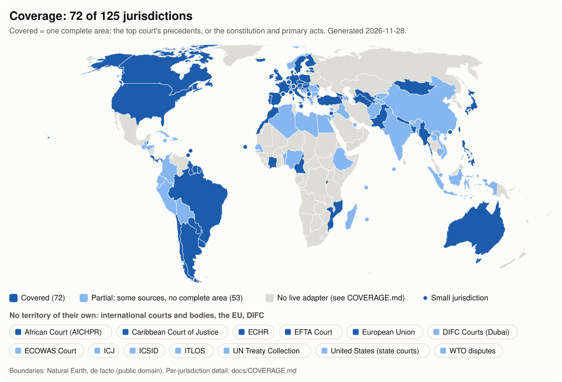
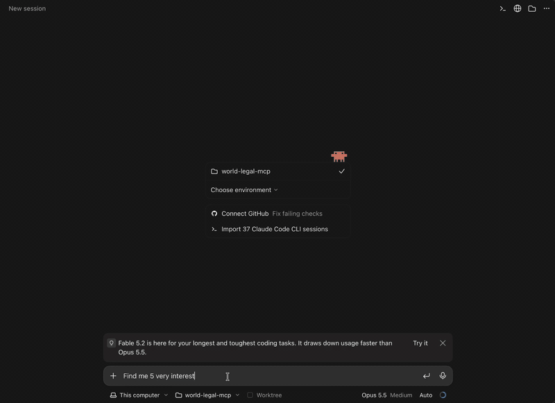

> 這是機器輔助的翻譯，以英文版本為準。

<h1 align="center">
  <picture>
    <source media="(prefers-color-scheme: dark)" srcset="../../assets/brand/lockup-dark.svg">
    
  </picture>
</h1>

<p align="center">
  超過 120 个法域的法律，問一句就有。
</p>

> **測試版（v0.1）。** Fontes 是即時讀法院佮政府的網站，毋過這寡網站會無通知就改變。
> 有一寡檢索可能會失敗、走甲真慢，抑是揣無啥物結果。逐个來源今仔日的狀態攏佇
> [狀態頁](https://ykarapazar.github.io/fontes/status/?lang=nan-Hant)，逐工檢查。若是有結果看起來毋著，
> 請共阮講：叫你的 AI 應用程式「回報 Fontes 的錯誤」，抑是[提出 issue](https://github.com/ykarapazar/fontes/issues)。

<p align="center">
  <a href="../../../LICENSE"></a>
  <a href="../../../pyproject.toml"></a>
  <a href="https://pypi.org/project/fontes-mcp/"></a>
  <a href="https://modelcontextprotocol.io"></a>
  <a href="https://ykarapazar.github.io/fontes/status/"></a>
</p>

<!-- languages:start -->
語言: **臺灣台語** · [English](../../../README.md) · [简体中文](../zh-Hans/README.md) · [हिन्दी](../hi/README.md) · [español](../es/README.md) · [العربية](../ar/README.md) · [français](../fr/README.md) · [বাংলা](../bn/README.md) · [português](../pt/README.md) · [Indonesia](../id/README.md) · [اردو](../ur/README.md)

<details>
<summary>All 80 languages</summary>

- **Europe:** [English](../../../README.md) · [français](../fr/README.md) · [Deutsch](../de/README.md) · [русский](../ru/README.md) · [italiano](../it/README.md) · [polski](../pl/README.md) · [Nederlands](../nl/README.md) · [português europeu](../pt-PT/README.md) · [română](../ro/README.md) · [Türkçe](../tr/README.md) · [svenska](../sv/README.md) · [čeština](../cs/README.md) · [magyar](../hu/README.md) · [Ελληνικά](../el/README.md) · [català](../ca/README.md) · [српски](../sr/README.md) · [srpski](../sr-Latn/README.md) · [български](../bg/README.md) · [dansk](../da/README.md) · [slovenčina](../sk/README.md) · [shqip](../sq/README.md) · [hrvatski](../hr/README.md) · [suomi](../fi/README.md) · [norsk bokmål](../nb/README.md) · [norsk nynorsk](../nn/README.md) · [bosanski](../bs/README.md) · [босански](../bs-Cyrl/README.md) · [lietuvių](../lt/README.md) · [slovenščina](../sl/README.md) · [Gaeilge](../ga/README.md) · [latviešu](../lv/README.md) · [eesti](../et/README.md) · [Malti](../mt/README.md) · [Lëtzebuergesch](../lb/README.md) · [íslenska](../is/README.md) · [հայերեն](../hy/README.md) · [ქართული](../ka/README.md) · [azərbaycan](../az/README.md)
- **Middle East & North Africa:** [العربية](../ar/README.md) · [فارسی](../fa/README.md) · [עברית](../he/README.md) · [کوردیی ناوەندی](../ckb/README.md) · [ⵜⴰⵎⴰⵣⵉⵖⵜ](../zgh/README.md)
- **Sub-Saharan Africa:** [አማርኛ](../am/README.md) · [Èdè Yorùbá](../yo/README.md) · [Malagasy](../mg/README.md) · [Wolof](../wo/README.md) · [Ikinyarwanda](../rw/README.md)
- **South & Central Asia:** [हिन्दी](../hi/README.md) · [বাংলা](../bn/README.md) · [اردو](../ur/README.md) · [தமிழ்](../ta/README.md) · [پښتو](../ps/README.md) · [नेपाली](../ne/README.md) · [o‘zbek](../uz/README.md) · [ўзбекча](../uz-Cyrl/README.md) · [тоҷикӣ](../tg/README.md) · [türkmen dili](../tk/README.md) · [кыргызча](../ky/README.md) · [རྫོང་ཁ](../dz/README.md) · [ދިވެހި](../dv/README.md)
- **East & Southeast Asia:** [简体中文](../zh-Hans/README.md) · [繁體中文](../zh-Hant/README.md) · **臺灣台語** · [臺灣客家語](../hak-Hant/README.md) · [日本語](../ja/README.md) · [Tiếng Việt](../vi/README.md) · [Indonesia](../id/README.md) · [Filipino](../fil/README.md) · [မြန်မာ](../my/README.md) · [Melayu](../ms/README.md) · [ខ្មែរ](../km/README.md) · [ລາວ](../lo/README.md) · [монгол](../mn/README.md)
- **Americas & Pacific:** [español](../es/README.md) · [português](../pt/README.md) · [Runasimi](../qu/README.md) · [Aymar aru](../ay/README.md) · [Avañeʼẽ](../gn/README.md) · [Kreyòl ayisyen](../ht/README.md)

</details>
<!-- languages:end -->

Fontes 是免費、開放原始碼的 MCP 伺服器。伊予你的 AI 應用程式**佇政府佮法院的網站頂即時查法院裁判佮法規**，
涵蓋超過 120 个法域佮國際法院。逐筆結果攏有附原文的連結。伊是標準的 Model Context Protocol（MCP）
伺服器，所以佇任何會當執行本機 MCP 伺服器的應用程式內底攏會當用：Claude Desktop、Claude Code、
OpenAI Codex、Cursor、VS Code（GitHub Copilot）、Gemini CLI、Windsurf、Zed、LM Studio 等等。

- **予律師佮研究人員：** 用平常講話的方式問就會使。你的 AI 應用程式會檢索官方來源，引用伊揣著的內容，
  附來源的連結。
- **予開發者：** 一个 MCP 伺服器，七个固定的研究工具（另外閣有 `report_bug`）；法域是一个參數，
  所以加國家袂加工具。Python，Apache 2.0。

來源狀態（逐工檢查）：[ykarapazar.github.io/fontes/status/](https://ykarapazar.github.io/fontes/status/)
· 逐个法域的涵蓋範圍：[COVERAGE.md](../../COVERAGE.md)
· 問佮答：[FAQ.md](FAQ.md)

## 快速開始

1. **共 Fontes 加入你的應用程式。**
   - **Claude Desktop：** 對[最新版本](https://github.com/ykarapazar/fontes/releases/latest)下載
     Fontes 的 `.mcpb` 檔案，揤兩下，閣揤 **Install**。
   - **Codex：** `codex mcp add fontes -- uvx fontes-mcp`
   - **Claude Code：** `claude mcp add fontes -- uvx fontes-mcp`
   - **Cursor、VS Code、Gemini CLI、Zed、LM Studio、Cline 佮其他的應用程式：** 對
     [INSTALL.md](INSTALL.md#其他的應用程式) 複製適合你應用程式的設定片段貼起去。

   `uvx` 是佮 [uv](https://docs.astral.sh/uv/getting-started/installation/) 做伙來的。佇 macOS 抑是
   Linux 頂安裝 uv：`curl -LsSf https://astral.sh/uv/install.sh | sh`。佇 Windows
   （PowerShell）頂：`powershell -ExecutionPolicy ByPass -c "irm https://astral.sh/uv/install.ps1 | iex"`。
2. **重新啟動應用程式。** 共伊完全關掉，閣再拍開。
3. **問：** *「Fontes 會當檢索佗一寡法域？」* 伊應該會列出這寡國家。

**佇 Mac**，一鍵安裝程式會佇 Claude Desktop、Codex、Claude Code、Cursor、VS Code、Windsurf、
Gemini CLI、Zed、LM Studio 佮 Cline 內底設定 Fontes（你電腦頂有的逐个），閣問你欲加金鑰無。
請對[最新版本](https://github.com/ykarapazar/fontes/releases/latest)下載 Mac 安裝程式，執行進前請先關掉這寡應用程式。
Windows 安裝程式就欲推出。詳細：[INSTALL.md](INSTALL.md#一鍵安裝程式mac)。
有一寡來源需要免費的金鑰：請看 [KEYS.md](KEYS.md)。

<!-- map:start -->
<p align="center"><a href="COVERAGE.md"><picture><source media="(prefers-color-scheme: dark)" srcset="../../assets/coverage-map-dark.svg"></picture></a></p>
<!-- map:end -->

## 會當問啥物？

```text
揣 2023 年以來荷蘭最高法院有關競業禁止條款的裁判。
顯示《德國民法典》第 6 條。
揣 2020 年以來有提著 “duty of care” 的英國最高法院判決。
佇 HUDOC 內底檢索歐洲人權法院有關第 8 條佮監控的判決。
揣土耳其憲法法院有關言論自由的裁判。
Fontes 會當檢索佗一寡法域？
```

你的 AI 應用程式會揀法域佮工具，檢索官方來源，閣予你逐筆結果的連結。欲靠伊進前，請拍開連結讀原文。

<p align="center"></p>

## 會做啥、袂做啥

- **會：** 佇你問的時，即時對發布者家己的網站抑是 API 提資料。逐筆結果攏寫明伊的來源，附伊的 URL
  抑是官方識別碼，予你會當拍開原文。
- **袂：** 起資料庫、大量下載、共文本快取佇磁碟，抑是共你的問題送去當咧檢索的來源以外的任何所在。
  免帳號。除了這寡來源，Fontes 逐工會對 PyPI 做一擺版本檢查（會當用 `FONTES_NO_UPDATE_CHECK=1`
  關掉）；其他任何傳送（使用次數統計、錯誤回報）攏愛你選擇加入，而且會先問你。
- **袂**提供法律意見，嘛袂判斷文本的佗一个版本有權威性。各國的涵蓋範圍差真濟：有的有完整的裁判
  佮經過整合的現行法規，有的干焦一个法院，抑是干焦原公布版本的法律。下面的表佮
  `list_jurisdictions` 會講清楚逐个法域涵蓋啥物內容。

### 欲靠結果進前請先讀

- **毋是逐个來源攏是官方、有正本效力的版本。** 大部分是政府抑是法院的網站，毋過有一寡經過整合的
  現行條文明確聲明是非官方版本（干焦官方公報有正本效力），閣有少數來源毋是政府的（比如 LexiVox、
  LawPhil、Maqam、Wikisource）。Fontes 會佇回答內底用「非官方來源」的提示共這寡來源標出來。引用進前
  請核對官方公布的版本。
- **逐个來源攏有家己的條款。** 資料猶是受伊的發布者的授權條款約束；有的禁止商業使用，有的愛標示出處
  （比如 CC BY 來源），少數無許可就禁止自動化存取。需要許可的來源預設是**關掉的**（下面標做 OFF）。
  請看[來源、條款佮 robots.txt](#來源條款佮-robotstxt)。
- **AI 可能讀毋著。** 欲靠某一則裁判抑是條文進前，請讀伊的全文；千萬毋通干焦根據檢索摘錄抑是 AI 的
  摘要來引用。
- **來源會慢，嘛會有欠缺。** 法院可能較慢公開，抑是干焦公開一部分的裁判；經過整合的現行條文嘛可能猶未
  納入上新的修正。請核對文本的日期，佮 `list_jurisdictions` 為彼个法域列出來的欠缺。
- **毋是法律意見。** Fontes 是研究工具。用伊袂佮任何人成立律師佮當事人的委任關係，嘛袂當代替佇你
  問題發生的所在有執業資格的律師的意見。
- **無擔保。** Fontes 照「現狀」提供，無附任何形式的擔保；佇法律允准的範圍內，伊的作者對伊的使用方式
  無負責任。完整的條款佇 [LICENSE](../../../LICENSE)（Apache 2.0）第 7 條佮第 8 條。
- Fontes 是獨立的開放原始碼專案。伊佮伊所讀的任何法院、政府抑是發布者攏無隸屬關係，嘛無得著𪜶的背書。

## 做這个專案的原因

Fontes 是一位律師做的，為律師做的。=) 嘛是為著其他所有捌需要讀適用佇家己身上的法律的人。

法律是公開的。法院裁判佮法規是法院佮政府公布的，就是欲予人讀。毋過逐个國家攏用家己的方式、佇家己的網站、用家己的語言公布，閣有真濟網站是做予已經知影欲去佗揣的人用的。AI 助理會當鬥相共，毋過伊若看無來源，就會用臆的。

Fontes 共你的 AI 應用程式接去這寡官方來源。伊即時對公布裁判佮法規的法院佮政府提資料，逐筆結果攏連結到原文，而且家己無起任何資料庫。

我相信逐位律師佮逐个公民，毋管佇佗位，攏應該會當查著管伊的法律，閣用伊來保護家己的權利。所以 Fontes 是免費、開放原始碼的，予法律實務工作者佮公民平平會當用。

若是有物件歹去，抑是欠你需要的國家，請[提出 issue](https://github.com/ykarapazar/fontes/issues)。這是上有路用的鬥相共。

Yüce Karapazar

## 涵蓋範圍

逐个法域的裁判佮法規來源。`list_jurisdictions` 佮 [COVERAGE.md](../../COVERAGE.md) 有完整的細節。

<details>
<summary>涵蓋範圍表（代碼、法域、裁判、法規）</summary>

<!-- coverage:start -->
| 代碼 | 法域 | 裁判 | 法規 |
|---|---|---|---|
| `ad` | Andorra | Tribunal Constitucional del Principat d'Andorra: sentències and autes | Portal Jurídic del Principat d'Andorra (BOPA service, Govern d'Andorra / Consell General): consolidated laws and Government regulations, Consell General del Principat d'Andorra: Constitució (Catalan booklet PDF) |
| `af` | Afghanistan | — | Ministry of Justice laws database (de facto authority) |
| `afchpr` | African Court on Human and Peoples' Rights | AJUDATA, the African Court's case database (ajudata.african-court.org) | — |
| `al` | Albania | Gjykata e Lartë (High Court of Albania, gjykataelarte.gov.al) | Qendra e Botimeve Zyrtare (qbz.gov.al, Ministry of Justice) |
| `am` | Armenia | ARLIS, Armenian Legal Information System (unified official publication website; Ministry of Justice / Official Bulletin CJSC) | ARLIS, Armenian Legal Information System (unified official publication website; Ministry of Justice / Official Bulletin CJSC) |
| `ar` | Argentina | — | InfoLEG (national laws) |
| `at` | Austria | RIS (OGH, VfGH, VwGH, BVwG, LVwG, DSB) | RIS federal law |
| `au` | Australia (Commonwealth) | — | Federal Register of Legislation |
| `az` | Azerbaijan | e-qanun.az, Unified Electronic Database of Legal Acts (Ministry of Justice) （OFF） | e-qanun.az, Unified Electronic Database of Legal Acts (Ministry of Justice) （OFF） |
| `ba` | Bosnia and Herzegovina | Ustavni sud Bosne i Hercegovine (ustavnisud.ba) – decisions database | Vlada Federacije BiH (fbihvlada.gov.ba) – Hronološki registar zakona (Federation laws as published), Parlamentarna skupština BiH (parlament.ba) – Ustav BiH and Prečišćeni tekstovi zakona (state level) |
| `bb` | Barbados | Barbados Judicial System: judgments (barbadoslawcourts.gov.bb), CCJ judgment lists and PDFs (ccj.org) | Barbados Judicial System: Consolidated Laws (barbadoslawcourts.gov.bb) |
| `bd` | Bangladesh | Supreme Court of Bangladesh (supremecourt.gov.bd) – Judgments and Orders | Laws of Bangladesh (bdlaws.minlaw.gov.bd), Legislative and Parliamentary Affairs Division |
| `bg` | Bulgaria | Конституционен съд (Constitutional Court), constcourt.bg | Народно събрание (National Assembly), parliament.bg API: Constitution and laws as adopted |
| `bh` | Bahrain | Legislation and Legal Opinion Commission (هيئة التشريع والرأي القانوني), lloc.gov.bh （OFF） | Legislation and Legal Opinion Commission (هيئة التشريع والرأي القانوني), lloc.gov.bh （OFF） |
| `bj` | Benin | Cour constitutionnelle du Bénin: décisions (courconstitutionnelle.bj) | Secrétariat général du Gouvernement du Bénin: lois, décrets, ordonnances (sgg.gouv.bj) |
| `bo` | Bolivia | Tribunal Agroambiental – Buscador de Resoluciones (SISAGRO consultas) | Cámara de Diputados – Leyes Promulgadas (WP REST API), laws as promulgated, LexiVox – Bolivian legislation (constitution, laws, decree-laws, codes; unofficial) |
| `br` | Brazil | STF (Supreme Federal Court) | normas.leg.br |
| `bs` | The Bahamas | Find Case Law, The National Archives (UK): Judicial Committee of the Privy Council judgments, Court of Appeal of The Bahamas judgments (courtofappeal.org.bs), Supreme Court of The Bahamas judgments, The Judiciary of The Bahamas (courts.bs) | Statute Law of The Bahamas, Law Reform and Revision Commission (laws.bahamas.gov.bs) |
| `bt` | Bhutan | — | Depository of Laws (legislation.gov.bt), Office of the Attorney General of Bhutan |
| `bz` | Belize | Judgments of the Senior Courts of Belize, Belize Judiciary (belizejudiciary.org), CCJ judgment lists and PDFs (ccj.org), Find Case Law, The National Archives | Laws of Belize, Attorney General's Ministry (agm.gov.bz) |
| `ca` | Canada (federal) | Supreme Court of Canada | Justice Laws |
| `ccj` | Caribbean Court of Justice | CCJ judgment lists and PDFs (ccj.org) | — |
| `ch` | Switzerland (federal) | Federal Supreme Court (bger.ch) | Fedlex (SR) |
| `ci` | Côte d'Ivoire | Cour de cassation de Côte d'Ivoire: jurisprudence (eservices / sigcc) | Assemblée nationale de Côte d'Ivoire: lois (assnat.ci) |
| `cl` | Chile | — | BCN Ley Chile |
| `cm` | Cameroon | Cour suprême du Cameroun (coursupreme.cm) | Présidence de la République du Cameroun (prc.cm), Actes: lois, ordonnances, décrets |
| `cn` | China | Supreme People's Court guiding cases | — |
| `co` | Colombia | Corte Constitucional | Función Pública – Gestor Normativo (consolidated legislation) （OFF） |
| `cr` | Costa Rica | — | SINALEVI – Sistema Nacional de Legislación Vigente (Procuraduría General de la República, SCIJ) |
| `cu` | Cuba | — | Gaceta Oficial de la República de Cuba (gacetaoficial.gob.cu), Ministerio de Justicia de Cuba (Gaceta Oficial reposts) |
| `cv` | Cabo Verde | Tribunal Constitucional de Cabo Verde (tribunalconstitucional.cv), Supremo Tribunal de Justiça de Cabo Verde, jurisprudência (stj.cv), JURIS CV – Jurisprudência Cabo-verdiana (Conselho Superior da Magistratura Judicial) | Tribunal Constitucional de Cabo Verde (tribunalconstitucional.cv) |
| `cz` | Czechia | rozhodnuti.justice.cz (lower courts) | e-Sbírka |
| `de` | Germany (federal) | NeuRIS (federal courts, trial service) （OFF） | Gesetze im Internet |
| `difc` | DIFC Courts (Dubai) | DIFC Courts judgments （OFF） | — |
| `dk` | Denmark | — | Retsinformation |
| `do` | Dominican Republic | Tribunal Superior Electoral – visor de sentencias (visorpdf.tse.do) | — |
| `dz` | Algeria | Cour constitutionnelle (and former Conseil constitutionnel) of Algeria | Journal Officiel de la République Algérienne (JORADP), Secrétariat Général du Gouvernement |
| `ec` | Ecuador | Corte Constitucional del Ecuador – Buscador de Sentencias (public JSON backend) and signed decision PDFs (esacc storage) | — |
| `echr` | European Court of Human Rights | HUDOC | — |
| `ecowas` | ECOWAS Community Court of Justice | ECOWAS Community Court of Justice website (courtecowas.org), ECOWAS Court Law Reports (CCJELR), English volumes 2004-2017 (courtecowas.org) | — |
| `ee` | Estonia | — | Riigi Teataja |
| `efta` | EFTA Court | EFTA Court judgments | — |
| `eg` | Egypt | المحكمة الدستورية العليا – Supreme Constitutional Court portal (judgments, full text) | — |
| `es` | Spain | Constitutional Court only | BOE consolidated law |
| `et` | Ethiopia | — | House of Peoples' Representatives: published laws (Federal Negarit Gazeta PDFs, hopr.gov.et) |
| `eu` | European Union | CELLAR (CJEU) | CELLAR (EUR-Lex) |
| `fi` | Finland | Finlex (KKO/KHO precedents) | Finlex open data |
| `gb` (alias `uk`) | United Kingdom | Find Case Law (The National Archives, 2003 onward) | legislation.gov.uk |
| `ge` | Georgia | Courts of Georgia (2018–2020) | Matsne |
| `gr` | Greece | Areios Pagos | Government Gazette (FEK) （OFF） |
| `gt` | Guatemala | Corte de Constitucionalidad – sentencias PDF (jurisprudencia.cc.gob.gt) （部分） | — |
| `gy` | Guyana | CCJ judgment lists and PDFs (ccj.org) | Laws of Guyana, Ministry of Legal Affairs (mola.gov.gy) |
| `hk` | Hong Kong | — | Hong Kong e-Legislation (open data) |
| `hn` | Honduras | — | Biblioteca Virtual del Tribunal Superior de Cuentas (TSC) – laws, codes, regulations and decrees as published (PDF, mostly La Gaceta copies), ENAG – La Gaceta Digital (Diario Oficial de la República de Honduras) |
| `hr` | Croatia | Constitutional Court (in the gazette) | Narodne novine |
| `ht` | Haiti | — | Conseil Supérieur du Pouvoir Judiciaire (CSPJ): document library, Cour de cassation d'Haïti: Constitution PDF (1987 original) |
| `hu` | Hungary | Bírósági Határozatok Gyűjteménye | — |
| `icj` | International Court of Justice (ICJ) | International Court of Justice website (www.icj-cij.org): case pages and document search | International Court of Justice website (www.icj-cij.org): case pages and document search |
| `icsid` | ICSID (investment arbitration) | ICSID case database | — |
| `id` | Indonesia | — | JDIH Kementerian Sekretariat Negara (jdih.setneg.go.id) – Produk Hukum, Majelis Permusyawaratan Rakyat (www.mpr.go.id) – UUD NRI 1945 |
| `ie` | Ireland | — | Irish Statute Book, LRC Revised Acts |
| `il` | Israel | — | Knesset law database; Open Law Book (Wikisource, non-official) |
| `in` | India | Indian Supreme Court Judgments (AWS Open Data; Dattam Labs mirror of the Supreme Court's e-SCR) | India Code （OFF） |
| `iq` | Iraq | — | Kurdistan Parliament legislation database (قاعدة التشريعات), legislation.krd (Kurdistan Region of Iraq only) |
| `is` | Iceland | Ísland.is court rulings | — |
| `it` | Italy | — | Normattiva |
| `itlos` | ITLOS (International Tribunal for the Law of the Sea) | ITLOS case pages (www.itlos.org) | — |
| `jm` | Jamaica | Find Case Law, The National Archives (UK): Judicial Committee of the Privy Council judgments, Supreme Court of Jamaica judgments (supremecourt.gov.jm), Court of Appeal of Jamaica judgments (courtofappeal.gov.jm) | — |
| `jo` | Jordan | Constitutional Court of Jordan (المحكمة الدستورية), cco.gov.jo | — |
| `jp` | Japan | — | e-Gov 法令API |
| `kg` | Kyrgyzstan | Constitutional Court of the Kyrgyz Republic (constsot.kg) | — |
| `kh` | Cambodia | — | Council for the Development of Cambodia (CDC): Laws and Regulations |
| `la` | Laos | — | Official Gazette of the Lao PDR (Ministry of Justice): search index （部分） |
| `lb` | Lebanon | المجلس الدستوري / Constitutional Council of Lebanon (cc.gov.lb) | المجلس الدستوري / Constitutional Council of Lebanon (cc.gov.lb) |
| `li` | Liechtenstein | Fürstlicher Oberster Gerichtshof – Entscheidungen (www.ogh.li) | Lilex – Gesetzesdatenbank des Fürstentums Liechtenstein (Rechtsdienst der Regierung) |
| `lu` | Luxembourg | data.public.lu — Cour de cassation decisions (Administration judiciaire), yearly ZIPs of PDFs read member by member with HTTP Range | Legilux |
| `lv` | Latvia | E-lietas (anonymised decisions) | — |
| `ly` | Libya | المحكمة العليا - Supreme Court of Libya (alolya.gov.ly) | وزارة العدل - Ministry of Justice of Libya (aladel.gov.ly) |
| `ma` | Morocco | Constitutional Court of Morocco (cour-constitutionnelle.ma) – Decisions | Ministry of Justice legal portal Adala (adala.justice.gov.ma) |
| `mc` | Monaco | Legimonaco — Gouvernement Princier de Monaco (Direction des Affaires Juridiques): Constitution, codes, laws, ordinances, treaties and court decisions | Legimonaco — Gouvernement Princier de Monaco (Direction des Affaires Juridiques): Constitution, codes, laws, ordinances, treaties and court decisions |
| `md` | Moldova | Curtea Supremă de Justiție (Supreme Court of Justice), jurisprudenta.csj.md, Portalul Național al Instanțelor de Judecată (courts of appeal and district courts), instante.justice.md | Președinția Republicii Moldova: Constituția (consolidated PDF), presedinte.md |
| `me` | Montenegro | Ustavni sud Crne Gore (ustavnisud.me) – Sudska arhiva | — |
| `mg` | Madagascar | Haute Cour Constitutionnelle (hcc.gov.mg) | CNLegis – Centre National LEGIS, Primature (cnlegis.gov.mg) |
| `mm` | Myanmar | Supreme Court of the Union: Rulings and Case Management System (rcms.usc.gov.mm) | Supreme Court of the Union: laws, procedures and amending laws (unionsupremecourt.gov.mm) |
| `mn` | Mongolia | shuukh.mn, electronic database of court decisions (Judicial General Council of Mongolia) | — |
| `mt` | Malta | — | Legislation Malta (legislation.mt), Office of the State Advocate / Legislation Unit |
| `mu` | Mauritius | Find Case Law, The National Archives (UK): Judicial Committee of the Privy Council judgments, Supreme Court of Mauritius website (supremecourt.govmu.org): judgment search (subordinate courts) and legislation library （OFF） | Supreme Court of Mauritius website (supremecourt.govmu.org): judgment search (subordinate courts) and legislation library, Revised Laws of Mauritius, Attorney General's Office (attorneygeneral.govmu.org), National Assembly of Mauritius (mauritiusassembly.govmu.org): Acts as passed （OFF） |
| `mv` | Maldives | — | MvLaw (mvlaw.gov.mv), Attorney General's Office legislation database, Government Gazette of the Maldives (gazette.gov.mv), President's Office |
| `mz` | Mozambique | Tribunal Supremo (ts.gov.mz): judgments tables of the TS and the Tribunais Superiores de Recurso, and its legislation page, Conselho Constitucional (cconstitucional.org.mz): acórdãos and deliberações | Tribunal Supremo (ts.gov.mz): judgments tables of the TS and the Tribunais Superiores de Recurso, and its legislation page |
| `ng` | Nigeria | Supreme Court of Nigeria | National Assembly of Nigeria (nass.gov.ng) – Acts as passed, Nigerian Investment Promotion Commission (nipc.gov.ng) – Acts, PLAC Laws of Nigeria (lawsofnigeria.placng.org): unrevised LFN 2004 (unofficial), FAOLEX (FAO) – Constitution of Nigeria 1999, consolidated to 2023 (PLAC print) |
| `nl` | Netherlands | rechtspraak.nl | wetten.overheid.nl (BWB) |
| `no` | Norway | Supreme Court (official summaries only) | — |
| `np` | Nepal | Nepal Kanoon Patrika (नेपाल कानून पत्रिका), Supreme Court of Nepal | — |
| `pa` | Panama | Legispan – Asamblea Nacional de Panamá (texts as published in the Gaceta Oficial, including Supreme Court rulings published there) | Legispan – Asamblea Nacional de Panamá (texts as published in the Gaceta Oficial, including Supreme Court rulings published there) |
| `pe` | Peru | Tribunal Constitucional – Consulta de causas and published resolutions | El Peruano – Diario Oficial, Búsquedas (Editora Perú): norms as published, Congreso de la República – Constitución Política del Perú, edición oficial (consolidated) |
| `ph` | Philippines | The LawPhil Project (lawphil.net), Arellano Law Foundation: non-official (NGO) | The LawPhil Project (lawphil.net), Arellano Law Foundation: non-official (NGO) |
| `pk` | Pakistan | Islamabad High Court (mis.ihc.gov.pk) – Case Law System | The Pakistan Code (pakistancode.gov.pk), Ministry of Law and Justice |
| `pl` | Poland | Portal Orzeczeń (common courts) | Sejm ELI API |
| `ps` | Palestine | Maqam – موسوعة القوانين وأحكام المحاكم الفلسطينية (An-Najah National University, Faculty of Law) – non-official (academic) | Maqam – موسوعة القوانين وأحكام المحاكم الفلسطينية (An-Najah National University, Faculty of Law) – non-official (academic) |
| `pt` | Portugal | DGSI, Tribunal Constitucional | PGDL (unofficial consolidations) |
| `py` | Paraguay | Corte Suprema de Justicia – Sistema de Información de Jurisprudencia | Biblioteca y Archivo Central del Congreso Nacional (BACN) – Leyes Paraguayas |
| `ro` | Romania | ÎCCJ decision by id only (no search) | cdep.ro index search only (no text) |
| `rs` | Serbia | Vrhovni sud (Supreme Court of Serbia): Baza sudske prakse | Ustavni sud (Constitutional Court): Ustav RS i propisi |
| `rw` | Rwanda | Portal of Rwandan Laws and Case Laws (amategeko.gov.rw), Rwanda Law Reform Commission and Judiciary of Rwanda | Portal of Rwandan Laws and Case Laws (amategeko.gov.rw), Rwanda Law Reform Commission and Judiciary of Rwanda |
| `sc` | Seychelles | Judiciary of Seychelles website (judiciary.sc): Decisions from the Courts | Official Gazette of Seychelles (gazette.sc): Acts, S.I.s and Bills, Judiciary of Seychelles website (judiciary.sc): Laws of Seychelles (Constitution and main codes) |
| `se` | Sweden | Rättspraxis (Domstolsverket) | Riksdagen (SFS) |
| `sg` | Singapore | SG Courts judgments （OFF） | — |
| `si` | Slovenia | Sodna praksa | PISRS |
| `sk` | Slovakia | Supreme Court | Slov-Lex |
| `sn` | Senegal | Conseil constitutionnel du Sénégal (decisions and consolidated Constitution), JURICAF (AHJUCAF): Cour suprême decisions (unofficial) | Conseil constitutionnel du Sénégal (decisions and consolidated Constitution), Primature / Secrétariat général du Gouvernement (lois, décrets, codes), Ministère de la Justice du Sénégal (codes, lois and décrets as PDF) |
| `sr` | Suriname | Rechtspraak Suriname, Hof van Justitie (rechtspraak.sr) | Surinaamse wetten, De Nationale Assemblee (dna.sr) |
| `tj` | Tajikistan | Constitutional Court of the Republic of Tajikistan (constcourt.tj) | Constitutional Court of the Republic of Tajikistan (constcourt.tj), Official website of the President of the Republic of Tajikistan (president.tj), Базаи қонунгузории ҶТ, National Legislation Centre under the President of the Republic of Tajikistan (base.mmk.tj) |
| `tm` | Turkmenistan | Supreme Court of Turkmenistan (court.gov.tm) | Mejlis of Turkmenistan (mejlis.gov.tm), Supreme Court of Turkmenistan (court.gov.tm) |
| `tr` | Türkiye | Bedesten, Constitutional Court | Bedesten (mevzuat) |
| `tt` | Trinidad and Tobago | Judiciary of Trinidad and Tobago: Recent Judgments (ttlawcourts.org) and judgment PDFs (webopac.ttlawcourts.org), Find Case Law, The National Archives | Digital Legislative Library, Law Revision Commission (laws.gov.tt) |
| `tw` | Taiwan | Judicial Yuan (FJUD) | MOJ law texts by pcode (no search) |
| `untc` | UN Treaty Collection (multilateral treaties deposited with the UN Secretary-General) | — | United Nations Treaty Collection (treaties.un.org), MTDSG status records and certified true copies |
| `us` | United States (federal) | govinfo | US Code (uscode.house.gov) |
| `uy` | Uruguay | BJN (Poder Judicial) | IMPO |
| `uz` | Uzbekistan | lex.uz, National Database of Legislation (Ministry of Justice, 'Adolat' National Legal Information Centre) | lex.uz, National Database of Legislation (Ministry of Justice, 'Adolat' National Legal Information Centre) |
| `vn` | Vietnam | Tòa án nhân dân tối cao: Trang tin điện tử về án lệ (anle.toaan.gov.vn) | Bộ Tư pháp: Cơ sở dữ liệu quốc gia về văn bản pháp luật (vbpl.vn), Cổng Thông tin điện tử Chính phủ: Hệ thống văn bản (vanban.chinhphu.vn) |
| `wto` | WTO dispute settlement (World Trade Organization) | WTO dispute pages and dispute data files (www.wto.org) | — |
| `xk` | Kosovo | Gjykata Kushtetuese e Republikës së Kosovës (Constitutional Court), gjk-ks.org | Gazeta Zyrtare e Republikës së Kosovës (Official Gazette, Office of the Prime Minister), gzk.rks-gov.net |
<!-- coverage:end -->

</details>

OFF = 彼个來源的條款愛有營運者的許可，所以預設是關掉的。干焦佇你提著彼个許可了後，才會使設定
`WLM_PERMITTED=<code>`（請看來源表）。

`list_jurisdictions` 會予你逐个法域準確的涵蓋範圍佮欠缺。

## 工具

| 工具 | 做啥物 |
|---|---|
| `list_jurisdictions(query?)` | 代碼、名稱、來源、支援的工具，佮逐个法域另外的篩選條件。請第一个呼叫。 |
| `search_caselaw(jurisdiction, query, limit=10, page=1, filters={})` | 全文檢索法院裁判。 |
| `get_decision(jurisdiction, id, max_chars=60000, offset=0)` | 用 markdown 格式提一則裁判（nl：ECLI；gb：neutral citation 抑是 slug）。 |
| `search_legislation(jurisdiction, query, limit=20, page=1, filters={})` | 揣法律 / 法令 / 法規命令。 |
| `get_legislation_toc(jurisdiction, id, keyword?)` | 法律的架構，有條文標號。 |
| `get_legislation_provision(jurisdiction, id, provision)` | 某一條 / 節 / 規定。 |
| `get_legislation_text(jurisdiction, id, max_chars=60000, offset=0)` | 完整的經過整合的現行條文，會當分頁。 |
| `report_bug(note?)` | 準備一份有關 Fontes 的錯誤回報。你會先看著；干焦佇你確認了後才會送出去。請看 [PRIVACY.md](PRIVACY.md)。 |

逐个法域的篩選條件（毋捌的篩選名稱會予人拒絕，同時傳回有效名稱的清單）：

- `nl` 裁判：`field`（alle/tekst/samenvatting/ecli/zaaknummer/vindplaats），`sort`
  （relevantie/publicatie/uitspraak/uitspraak_asc），`period`（week/maand/dit_jaar/vorig_jaar）。
  法規：`current_only`（預設 true）。
- `gb` 裁判：`court`（比如 `uksc,ewca/civ`），`party`，`judge`，`order`（`-date`/`date`/`-updated`/`updated`）。
  法規：`search_in`（`title`/`text`），`doc_type`（`ukpga`、`uksi`……），`year`。

## 安裝

逐个應用程式（Claude Desktop、Codex、Claude Code、Cursor、VS Code、Gemini CLI、Zed、LM Studio、Cline）
一步一步的說明：[INSTALL.md](INSTALL.md)。

**開發者：** 你需要 [uv](https://docs.astral.sh/uv/getting-started/installation/)。

```bash
uvx fontes-mcp                 # from PyPI
uvx --from git+https://github.com/ykarapazar/fontes fontes   # straight from GitHub
uvx fontes-mcp --only nl,gb    # expose only some jurisdictions
```

Fontes 是 stdio MCP 伺服器：由 MCP 用戶端啟動伊，你免家己用手執行。
`nl-legal-mcp` 佮 `uk-legal-mcp`（舊名）分別是 `fontes --only nl` / `--only gb` 的別名。

<details>
<summary>選用的環境變數</summary>

選用的環境變數：`WLM_US_GOVINFO_KEY`（用來檢索美國裁判的免費 api.data.gov 金鑰），
`WLM_FR_PISTE_CLIENT_ID` + `WLM_FR_PISTE_CLIENT_SECRET`（無𪜶，法國就是關掉的：愛有一个已經訂閱
Judilibre 佮 Légifrance 的免費 piste.gouv.fr 應用程式，步驟佇 `research/fr.md`），
`WLM_PERMITTED=<codes>`（拍開條款需要許可的來源，干焦佇你提著許可了後才用），
`FONTES_NO_UPDATE_CHECK=1`。

</details>

大部分的應用程式用仝款的項目；設定檔佮上頂層的鍵名逐个應用程式無仝（請看
[INSTALL.md](INSTALL.md#其他的應用程式)）：

```json
{
  "mcpServers": {
    "fontes": {
      "command": "uvx",
      "args": ["fontes-mcp"]
    }
  }
}
```

### 確認有正常運作

問你的 AI 應用程式：*「Fontes 會當檢索佗一寡法域？」* 伊應該會列出這寡國家。

### 對原始碼執行（開發）

```bash
git clone https://github.com/ykarapazar/fontes && cd fontes
uv sync && uv run fontes --help
```

## 測試

```bash
uv run pytest -q                 # offline registry tests + live smoke tests (needs network)
uv run pytest tests/live/test_nl.py tests/live/test_conformance.py -k "test_nl or [nl]"  # one jurisdiction, live
uv run pytest tests/test_registry.py
```

## 加新的法域

完整的規範佇 [ADAPTER_SPEC.md](../../ADAPTER_SPEC.md)；請佮 `base.py` 佮 `models.py` 做伙讀。簡單講：

<details>
<summary>步驟佮規則</summary>

1. 揀代碼：ISO 3166-1 alpha-2 細寫（`de`），國家以下的層級 `us-ca`，國際 `eu`、`echr`。建立
   `src/world_legal_mcp/jurisdictions/<code>.py`（用有效的模組名稱，比如 `us_ca.py` 配
   `code = "us-ca"`）。伊會自動予人發現。
2. 繼承 `Jurisdiction`，設定 `code`、`name`、`languages`、`aliases`、`notes`、`samples`、
   `min_interval = {host: seconds}` 佮 `sources`：為逐个 `Source` 設定伊的授權、`commercial_use`、
   `ai_use`、`auth`、`rate_limit`（佮你按怎知影）佮 `terms_url`。
3. 干焦實作官方來源有支援的非同步方法（`search_caselaw`、`get_decision`、`search_legislation`、
   `get_legislation_toc`、`get_legislation_provision`、`get_legislation_text`）。傳回 `models.py`
   內底的紀錄，毋是 markdown；失敗的時擲出 `NotFound` / `BadRequest` / `SourceError`。無實作的方法會
   回報做無支援。
4. 佇 `caselaw_filters` / `legislation_filters` 內底宣告另外的檢索選項，閣對 `filters` 讀。用
   `_http.get/post`（本專案家己的 User-Agent，照主機限速）佮共用的 `_http` 輔助函式。
5. 加 `tests/live/test_<code>.py`，閣執行
   `uv run pytest tests/test_registry.py -q` 佮
   `uv run pytest tests/live/test_conformance.py -k "[<code>]" -s`（愛加方括號：干焦
   `-k <code>` 嘛會對著其他的測試）。

規則：干焦用官方抑是公部門的來源；千萬毋通擷取 robots.txt 抑是條款禁止的內容；識別碼來自來源，
千萬毋通家己捏造。條款規定自動化使用愛有許可的來源，設定 `needs_permission=True` 佮 `warning`：
除非營運者佇 `WLM_PERMITTED` 內底列出彼个代碼（比如 `WLM_PERMITTED=in,de`），伺服器絕對袂呼叫伊。

</details>

## 來源、條款佮 robots.txt

逐个請求攏佇伊的 User-Agent 內底寫明本專案
（`Fontes/<version> (+https://github.com/ykarapazar/fontes; fontesmcp@proton.me)`）；伊絕對袂假做瀏覽器。
請求是佇使用者問的時一个一个送出去，毋是用爬取的方式。若是你家己架設，逐个來源看著的營運者就是你，
所以部署進前請檢查正爿彼一欄。檢查的日期：2026-11-05/06。

**若是你營運其中一个來源**，而且阮有任何毋著（你的條款、你的 robots.txt、你的速率限制，抑是其他任何
代誌），請寄電子批到 fontesmcp@proton.me。阮會改正，抑是共彼个來源關掉。

「AI 使用」是講彼个來源的條款抑是 robots.txt 有反對 AI/TDM 使用的講法無（「無講明」是講無提著，毋是允准）。
標做「documented」的速率限制來自來源本身；其他的攏是阮家己設定的請求間隔。`list_jurisdictions`
會傳回仝款的資料。

<details>
<summary>來源表（授權、商業使用、AI 使用、驗證、速率限制、robots.txt）</summary>

<!-- sources:start -->
| 國家 | 來源（阮呼叫的主機） | 授權條款 | 商業使用 | AI 使用 | 驗證 | 速率限制 | robots.txt 佮家己架設的人愛知影的代誌 |
|---|---|---|---|---|---|---|---|
| ad | Tribunal Constitucional del Principat d'Andorra: sentències and autes (www.tribunalconstitucional.ad) | Unknown: the legal notice names the court as owner, says 'Tots els drets reservats' and is silent on reuse or automated access (checked 2026-11-06) | 毋知 | 無寫明 | 無 | Unknown, nothing documented; 1 s spacing, no 429 seen in ~10 requests (2026-11). robots.txt: Drupal default, no Crawl-delay (2026-11-06) |  |
| ad | Portal Jurídic del Principat d'Andorra (BOPA service, Govern d'Andorra / Consell General): consolidated laws and Government regulations (portaljuridicandorra.ad) | Govern d'Andorra legal notice: all rights reserved; only personal use of downloadable files is authorised, commercial use not permitted | **毋是** | 無寫明 | 無 | Robots.txt Crawl-Delay: 10 (checked 2026-11-06); 10 s spacing | Personal use only: Portal Jurídic terms allow personal use only, no commercial use; consolidated texts are unofficial (the BOPA is the only authentic version). |
| ad | Consell General del Principat d'Andorra: Constitució (Catalan booklet PDF) (www.consellgeneral.ad) | Unknown: consellgeneral.ad has no legal notice or terms page (checked 2026-11-10); the Constitution is an official text | 毋知 | 無寫明 | 無 | Unknown, nothing documented; 1 s spacing; one ~450 KB PDF, kept in a small in-memory cache; no 429 seen in ~10 requests (2026-11) |  |
| af | Ministry of Justice laws database (de facto authority) (laws.moj.gov.af) | Unknown; no terms or licence page, footer 'Copyright © 2019 \| MOJ. All Rights Reserved' | 毋知 | 無寫明 | 無 | Unknown; 2 s spacing, no 429 seen in ~30 requests (2026-11) | Site of the Ministry of Justice of the current de facto administration (Islamic Emirate); texts and in-force status reflect that administration. PDFs as published in the Official Gazette, not consolidated; text extracted from PDF, check the original. |
| afchpr | AJUDATA, the African Court's case database (ajudata.african-court.org) | © African Court on Human and Peoples' Rights, "All Rights Reserved" (site footer); no terms-of-use page and no clause on automated access | 毋知 | 無寫明 | 無 | Unknown; 1 s spacing, no 429 seen in ~25 requests (2026-11); page size fixed at 50 by the source |  |
| afchpr | African Union treaty page: African Charter on Human and Peoples' Rights and the Court's Protocol (au.int) | Not researched; link only, nothing is fetched from it | 毋知 | 無寫明 | 無 | 毋知 |  |
| afchpr | African Court website (Rules of Court) (www.african-court.org) | Not researched; link only, nothing is fetched from it | 毋知 | 無寫明 | 無 | 毋知 |  |
| al | Qendra e Botimeve Zyrtare (qbz.gov.al, Ministry of Justice) | Not stated. FAQ: published information is accessible to the general public without any restriction | 毋知 | 無寫明 | 無 | Not published; 1 request/s self-imposed, no 429 seen in a handful of requests (2026-11-05) |  |
| al | Gjykata e Lartë (High Court of Albania, gjykataelarte.gov.al) | Not stated. Terms: the website is free to use and available to all users; only unlawful use is forbidden | 毋知 | 無寫明 | 無 | API sends x-ratelimit-limit: 50 (window not stated); 1.5 s between requests self-imposed |  |
| am | ARLIS, Armenian Legal Information System (unified official publication website; Ministry of Justice / Official Bulletin CJSC) (www.arlis.am) | No licence or terms published (footer: '© All rights reserved'); the texts are official documents, which Copyright Law HO-142-N art. 4(1)(c) excludes from copyright | 毋知 | 無寫明 | 無 | Unknown; 1 s spacing, no 429 seen in ~25 requests (2026-11) |  |
| ar | InfoLEG (www.argentina.gob.ar/normativa, Ministerio de Justicia) | Creative Commons Reconocimiento 2.5 Argentina (infoleg.gob.ar footer) | 毋知 | 無寫明 | 無 | Unknown; no robots.txt (404); 2 s spacing, no 429 seen in ~10 requests (2026-11) | Credit "InfoLEG – Ministerio de Justicia de la Nación". Consolidated texts are not official (only the Boletín Oficial is). **No case law: SAIJ's terms allow personal use only, so it is not used.** |
| ar | InfoLEG – Leyes Argentinas (Ministerio de Justicia, argentina.gob.ar/normativa) | Creative Commons Attribution 4.0 International (argentina.gob.ar Términos y condiciones) | 是 | 無寫明 | 無 | Robots.txt Crawl-delay: 10 (checked 2026-11-05); 10 s spacing | CC BY 4.0: credit 'InfoLEG – Ministerio de Justicia de la Nación' when reusing. Consolidated texts are not official; only the Boletín Oficial is authentic. |
| at | RIS — Rechtsinformationssystem des Bundes (OGD API v2.6) (data.bka.gv.at) | CC BY 4.0 (stated in the RIS OGD FAQ at data.bka.gv.at/ris/api/v2.6/) | 是 | 無寫明 | 無 | Documented: max 0.5 req/s (2 s gap), no parallel connections; anything beyond manual-scale use must be announced to ris.it@bka.gv.at and run 20:00–05:00 or weekends (RIS OGD FAQ, read 2026-11-05). Using 2 s spacing. | robots.txt `Disallow: /` for all clients; officially documented open-data API, read as a template rule (unconfirmed). **Anything beyond manual-scale use must be announced to ris.it@bka.gv.at** and run 20:00–05:00 or weekends. |
| au | Federal Register of Legislation (api.prod.legislation.gov.au) | CC BY 4.0 (attribute to the Federal Register of Legislation and link legislation.gov.au; Coat of Arms and third-party material excluded) | 是 | 是 | 無 | Unknown (none published; API is the site's own backend); 1 s spacing, no 429 seen in ~30 requests (2026-11-05) | Undocumented site backend. www robots.txt: Crawl-delay 10; API host has none. |
| az | e-qanun.az, Unified Electronic Database of Legal Acts (Ministry of Justice) | Unknown: no terms page; footer says 'Bütün Haqqlar Qorunur' (All Rights Reserved). Official texts are excluded from copyright under the Azerbaijani Copyright Law (art. 7; unverified) | 毋知 | 無寫明 | 無 | Unknown; 1 s spacing, no 429 seen in ~80 requests (2026-11) | e-qanun.az serves its text files only with an e-qanun.az Referer header (hotlink protection); this adapter sends one. Off until the operator decides that is acceptable. **預設是關的 — 愛 WLM_PERMITTED=az 閣愛營運者已經提著的許可。** |
| ba | Ustavni sud Bosne i Hercegovine (ustavnisud.ba) – decisions database | Unknown: no terms of use on the site (footer 'Copyrights @ 2026 Ustavni sud BiH Sva prava zadržana.'); official court decisions | 毋知 | 無寫明 | 無 | Unknown; 1 s spacing, no 429 seen in ~25 requests (2026-11) |  |
| ba | Vlada Federacije BiH (fbihvlada.gov.ba) – Hronološki registar zakona (Federation laws as published) | Unknown: no terms of use on the site (footer 'Copyright 2021. Vlada Federacije Bosne i Hercegovine'); official legislative texts | 毋知 | 無寫明 | 無 | Unknown; 1 s spacing, no 429 seen in ~20 requests (2026-11) | Federation of BiH entity laws only, as published in Službene novine FBiH (not consolidated; state, Republika Srpska and Brčko laws are not covered). |
| ba | Parlamentarna skupština BiH (parlament.ba) – Ustav BiH and Prečišćeni tekstovi zakona (state level) | Unknown: no terms of use found on the site; official Parliament publication. The consolidated texts are the Parliament's UNOFFICIAL consolidations (Neslužbeni prečišćeni tekst); only the Službeni glasnik BiH text is authentic | 毋知 | 無寫明 | 無 | Unknown; 1 s spacing, no 429 seen in ~25 requests (2026-11) | State-level acts: the Constitution (with Amandman I) and the Parliament's unofficial consolidated texts, a selection of state acts (not every act); the authentic text is in Službeni glasnik BiH. |
| bb | Barbados Judicial System: judgments (barbadoslawcourts.gov.bb) | 'Copyright Barbados Judicial System 2015 - 2026. All Rights Reserved.' No licence; the 'Terms & Conditions' footer link is empty (no terms page, checked 2026-11-05); silent on reuse and automated access | 毋知 | 無寫明 | 無 | Robots.txt Crawl-delay: 10 (honoured: 10 s spacing); no 429 in ~12 requests (2026-11) |  |
| bb | Barbados Judicial System: Consolidated Laws (barbadoslawcourts.gov.bb) | 'Copyright Barbados Judicial System 2015 - 2026. All Rights Reserved.' No licence; the 'Terms & Conditions' footer link is empty (no terms page, checked 2026-11-05); silent on reuse and automated access | 毋知 | 無寫明 | 無 | Robots.txt Crawl-delay: 10 (honoured: 10 s spacing; law lists cached in memory 6 h) | Laws are OCR text of scanned printed revised editions (1971 / L.R.O. 1985 and later reprints): may predate amendments and contain OCR errors; check the PDF. |
| bb | CCJ judgment lists and PDFs (ccj.org) | © Caribbean Court of Justice; no licence stated (the Terms of Use page is empty, 2026-11-05) | 毋知 | 無寫明 | 無 | Unknown; 1 s spacing, both lists cached in memory 6 h; no 429 seen in ~20 requests (2026-11) |  |
| bd | Laws of Bangladesh (bdlaws.minlaw.gov.bd), Legislative and Parliamentary Affairs Division | Unknown: no terms of use or licence; page footer 'Copyright © 2019, Legislative and Parliamentary Affairs Division' | 毋知 | 無寫明 | 無 | Unknown; 1 s spacing, no 429 seen in ~20 requests (2026-11) |  |
| bd | Supreme Court of Bangladesh (supremecourt.gov.bd) – Judgments and Orders | Unknown: no terms of use, copyright or licence statement on the site | 毋知 | 無寫明 | 無 | Unknown; 1 s spacing, no 429 seen in ~10 requests (2026-11) |  |
| bg | Конституционен съд (Constitutional Court), constcourt.bg | No licence or terms page; footer says 'съдържанието е обект на авторско право' (content is copyrighted), but official acts of state bodies are excluded from copyright (ЗАПСП art. 4 item 1) | 毋知 | 無寫明 | 無 | Unknown; 1 s spacing, no 429 in ~20 requests (2026-11-06); Cloudflare-fronted |  |
| bg | Народно събрание (National Assembly), parliament.bg API: Constitution and laws as adopted | No terms page; laws are excluded from copyright (ЗАПСП art. 4 item 1) | 毋知 | 無寫明 | 無 | Unknown; 1 s spacing, no 429 in ~40 requests (2026-11-06, -10) |  |
| bh | Legislation and Legal Opinion Commission (هيئة التشريع والرأي القانوني), lloc.gov.bh | Site terms: content is copyright LLOC; modifying it or using it 'for any other purposes' is called an infringement. Separately, Bahraini copyright law (22/2006 art. 4(b)) excludes legislation and judgments from copyright, but that does not lift the site's terms on automated use: reuse still needs LLOC's permission. | 毋知 | 無寫明 | 無 | Unknown; 1 s spacing, no 429 seen in ~40 requests (2026-11) | LLOC's terms reserve copyright and forbid modifying content or using it 'for other purposes'; texts are passed on unmodified for reference. Check the official PDF before relying on them. Even with permission this source holds legislation and Constitutional Court judgments only, not Court of Cassation judgments. **預設是關的 — 愛 WLM_PERMITTED=bh 閣愛營運者已經提著的許可。** |
| bj | Cour constitutionnelle du Bénin: décisions (courconstitutionnelle.bj) | No terms published; footer '© Cour Constitutionnelle du Bénin - 2023' | 毋知 | 無寫明 | 無 | Unknown; 1 s spacing, no 429 seen in ~20 requests (2026-11) |  |
| bj | Secrétariat général du Gouvernement du Bénin: lois, décrets, ordonnances (sgg.gouv.bj) | No terms (mentions légales page is empty); footer '© Présidence de la République du Bénin - 2026' | 毋知 | 無寫明 | 無 | Unknown; 1 s spacing, no 429 seen in ~20 requests (2026-11) | Texts as promulgated, not consolidated; many recent PDFs are image-only scans with no extractable text. |
| bo | Tribunal Agroambiental – Buscador de Resoluciones (SISAGRO consultas) (arbol.tribunalagroambiental.bo) | Unknown: no terms-of-use or licence page on tribunalagroambiental.bo (checked 2026-11-06); court resolutions are official texts | 毋知 | 無寫明 | 無 | Unknown; robots.txt allows all, no crawl-delay (2026-11-06); 1 s spacing, no 429 seen in ~10 requests |  |
| bo | Cámara de Diputados – Leyes Promulgadas (WP REST API), laws as promulgated (diputados.gob.bo) | Unknown: no terms-of-use page; site footer says '©2025. Cámara de Diputados. Todo los derechos reservados.' (checked 2026-11-06); laws are official texts | 毋知 | 無寫明 | 無 | Unknown; robots.txt is 404 (no rules, 2026-11-06); 1 s spacing, no 429 seen in ~15 requests | Bolivian law texts here are the laws as promulgated (PDF, partly OCR'd by the source), not consolidated: check later amending laws. |
| bo | LexiVox – Bolivian legislation (constitution, laws, decree-laws, codes; unofficial) (www.lexivox.org) | GFDL / CC BY-SA 3.0: lexivox.org/terminos.html lets reusers copy, modify and redistribute the content with attribution (link to the source URL); each norm page says 'Derechos GFDL' (checked 2026-11-10). Run by DeveNet S.R.L., La Paz | 是 | 無寫明 | 無 | Unknown; robots.txt is 404 and pages carry meta robots ALL (2026-11-10); 1 s spacing, no 429 seen in ~15 requests | LexiVox is a private, unofficial compilation of Bolivian norms as published (texts transcribed from the Gaceta Oficial, not consolidated, no legal authority): check the Gaceta Oficial and later amending laws. |
| br | STF – Pesquisa de Jurisprudência (Supremo Tribunal Federal) (jurisprudencia.stf.jus.br) | Unknown: no STF terms of use found; judicial decisions are excluded from copyright under Lei 9.610/1998 art. 8, IV | 毋知 | 無寫明 | 無 | Unknown: nothing published; jurisprudencia.stf.jus.br has no robots.txt (the SPA answers every path); 1 s spacing, no 429 seen in ~15 requests (2026-11-05). Undocumented internal API: may change without notice. | No robots.txt. Undocumented internal API; may change without notice. |
| br | normas.leg.br (Senado Federal / Câmara dos Deputados) – consolidated federal legislation | CC BY 4.0 (declared in every record's license/sdLicense); Senado portal policy: reuse allowed for lawful purposes with attribution | 是 | 無寫明 | 無 | Unknown: nothing published; normas.leg.br robots.txt allows all; legis.senado.leg.br robots.txt answers 403 (no rules readable). 1 s spacing, no 429 seen in ~20 requests (2026-11-05) | robots.txt allows all (legis.senado.leg.br's answers 403). |
| bs | Find Case Law, The National Archives (UK): Judicial Committee of the Privy Council judgments (caselaw.nationalarchives.gov.uk) | Open Justice Licence v2.0: free re-use incl. commercial; 'computational analysis' (programmatic bulk searching to identify, extract or enrich records) needs a separate, free licence | 是 | **毋是** | 無 | Documented: 1,000 requests / rolling 5 min per IP, HTTP 429 when exceeded (API docs, checked 2026-11) |  |
| bs | Statute Law of The Bahamas, Law Reform and Revision Commission (laws.bahamas.gov.bs) | Government of The Bahamas Copyright: 'Any reproduction shall ensure its accuracy, and the source and copyright status of the material is made evident to users. The website may only be used for informational non-commercial purposes' | **毋是** | 無寫明 | 無 | Unknown; no Crawl-delay; 1 s spacing, index and letter lists cached in memory 6 h; no 429 in ~15 requests (2026-11) | Statute Law of The Bahamas: Government copyright, informational non-commercial use only; not the authoritative text (that is the printed Revised Edition and the Official Gazette). |
| bs | Court of Appeal of The Bahamas judgments (courtofappeal.org.bs) | © Court of Appeal of the Commonwealth of The Bahamas, all rights reserved; no licence or terms of use; the site's only policy page is a privacy/data policy (read 2026-11-05) | 毋知 | 無寫明 | 無 | Unknown; no Crawl-delay; 1 s spacing, no 429 in ~10 requests (2026-11) |  |
| bs | Supreme Court of The Bahamas judgments, The Judiciary of The Bahamas (courts.bs) | © The Judiciary of The Bahamas; no licence or terms of use; the site's only policy page is a privacy/data policy (read 2026-11-05) | 毋知 | 無寫明 | 無 | Unknown; no robots.txt; 1 s spacing, the one-page judgment list (~1.2 MB) cached in memory 6 h; no 429 in ~10 requests (2026-11) |  |
| bt | Depository of Laws (legislation.gov.bt), Office of the Attorney General of Bhutan | None stated (no terms, licence or copyright notice on the site, 2026-11) | 毋知 | 無寫明 | 無 | Unknown; 1 s spacing, no 429 seen in ~25 requests (2026-11) |  |
| bz | Judgments of the Senior Courts of Belize, Belize Judiciary (belizejudiciary.org) | '© 2024 Belize Supreme Court Judiciary' footer; no licence or terms-of-use page (checked 2026-11-06) | 毋知 | 無寫明 | 無 | Unknown; no robots.txt, no Crawl-delay; 1 s spacing, no 429 in ~25 requests (2026-11) |  |
| bz | Laws of Belize, Attorney General's Ministry (agm.gov.bz) | '© 2022 By The Attorney General's Ministry of Belize - All Rights Reserved' footer; no terms-of-use page (checked 2026-11-06) | 毋知 | 無寫明 | 無 | Unknown; no robots.txt, no Crawl-delay; 1 s spacing, no 429 in ~25 requests (2026-11) |  |
| bz | CCJ judgment lists and PDFs (ccj.org) | © Caribbean Court of Justice; no licence stated (the Terms of Use page is empty, 2026-11-05) | 毋知 | 無寫明 | 無 | Unknown; 1 s spacing, both lists cached in memory 6 h; no 429 seen in ~20 requests (2026-11) |  |
| bz | Find Case Law, The National Archives (caselaw.nationalarchives.gov.uk) | Open Justice Licence v2.0: free re-use incl. commercial; 'computational analysis' (programmatic bulk searching to identify, extract or enrich records) needs a separate, free licence | 是 | **毋是** | 無 | Documented: 1,000 requests / rolling 5 min per IP, HTTP 429 when exceeded (API docs, checked 2026-11) |  |
| ca | Supreme Court of Canada judgments (decisions.scc-csc.ca, hosted by Lexum for the Court) | Reasons for judgment: Reproduction of Federal Law Order (SI/97-5), free reproduction incl. commercial if accurate and not presented as official. Headnotes and editorial features (paragraph numbers, lists of authorities): commercial reproduction needs the Court's written permission | Reasons: yes. Headnotes/editorial features: written permission | 是 | 無 | Unknown; 1 s spacing, no 429 seen (2026-11) | robots.txt blocks only one crawler (BUbiNG). |
| ca | Justice Laws Website, Department of Justice Canada (laws-lois.justice.gc.ca) | Open Government Licence – Canada (open.canada.ca XML dataset); also Reproduction of Federal Law Order (not to be presented as official) | 是 | 是 | 無 | Unknown; 1 s spacing, no 429 seen (2026-11) | No robots.txt. Must not be presented as the official version. |
| ccj | CCJ judgment lists and PDFs (ccj.org) | © Caribbean Court of Justice; no licence stated (the Terms of Use page is empty, 2026-11-05) | 毋知 | 無寫明 | 無 | Unknown; 1 s spacing, both lists cached in memory 6 h; no 429 seen in ~20 requests (2026-11) |  |
| ch | Federal Supreme Court (search.bger.ch) | Unknown: no reuse terms published; the site footer says '© Alle Rechte vorbehalten', but court decisions are not copyright-protected in Switzerland (Art. 5(1)(c) URG, SR 231.1) | 毋知 | 無寫明 | 無 | Robots.txt Crawl-delay: 2 (read 2026-11-05); using 2 s spacing, no 429 seen in a handful of requests (2026-11) |  |
| ch | Fedlex (fedlex.data.admin.ch SPARQL + www.fedlex.admin.ch/filestore) | Not copyright-protected (Art. 5 URG); free reuse under Art. 49 PublV (SR 170.512.1): text unchanged, kept apart from comments, with the notice 'Dies ist keine amtliche Veröffentlichung...'; paid redistribution only in value-added form | 是 | 無寫明 | 無 | Unknown, nothing documented; 1 s spacing on both hosts, no 429 seen (2026-11). fedlex.data.admin.ch robots.txt disallows /filestore/*, so files are read from www.fedlex.admin.ch/filestore (allowed) | **fedlex.data.admin.ch robots.txt disallows `/filestore/*`**; we fetch the same files from the www host, whose robots.txt allows them (what the Fedlex viewer itself loads). Defensible, not confirmed with Fedlex. |
| ci | Cour de cassation de Côte d'Ivoire: jurisprudence (eservices / sigcc) (eservices.courdecassation.ci) | No terms published; footer '© Copyright 2026. Tous Droits Réservés' | 毋知 | 無寫明 | 無 | Unknown; 1 s spacing, no 429 seen in ~25 requests (2026-11) |  |
| ci | Assemblée nationale de Côte d'Ivoire: lois (assnat.ci) | No terms published; footer 'Copyright ©2019 assnat.ci - Tous droits réservés' | 毋知 | 無寫明 | 無 | Unknown; 1 s spacing, no 429 seen in ~25 requests (2026-11) | Texts as adopted by the Assemblée nationale (not consolidated, mostly 2012-2020); the Journal officiel is the authentic version. |
| cl | BCN Ley Chile (www.leychile.cl, nuevo.leychile.cl) | Legal texts are excluded from copyright (Ley 17.336 art. 11 b); bcn.cl portal metadata declares CC BY-SA 3.0 CL; no Ley Chile terms page found | 毋知 | 無寫明 | 無 | Unknown; 1 s spacing, no 429 seen in ~15 requests (2026-11-05); no robots.txt on leychile.cl / bcn.cl | No robots.txt. No Ley Chile terms page found. |
| cm | Cour suprême du Cameroun (coursupreme.cm) | 'Copyright © 2019 CSC. All Rights Reserved' (site footer); no terms of use or licence page (checked 2026-11-06) | 毋知 | 無寫明 | 無 | Unknown; robots.txt 404 (no rules, no Crawl-delay); 1 s spacing, no 429 in ~15 requests (2026-11) |  |
| cm | Présidence de la République du Cameroun (prc.cm), Actes: lois, ordonnances, décrets | 'Copyright © 2026 Présidence de la République du Cameroun - Tous droits réservés' (site footer); the 'Règles de confidentialité' page is empty; no terms of use (checked 2026-11-06) | 毋知 | 無寫明 | 無 | Unknown; robots.txt (Joomla default) only disallows system folders, no Crawl-delay; 1 s spacing, no 429 in ~30 requests (2026-11) |  |
| cn | Supreme People's Court of the PRC (最高人民法院), guiding cases (指导性案例) (www.court.gov.cn) | None published; site footer: 中华人民共和国最高人民法院 版权所有 (all rights reserved) | 毋知 | 無寫明 | 無 | Unknown; 1 s spacing, no 429 seen in ~80 requests (2026-11-05) | No robots.txt. **No legislation: flk.npc.gov.cn robots.txt forbids all automated access.** China Judgments Online needs a login and is not used. |
| co | Corte Constitucional – relatoría (sentencias, full text) (www.corteconstitucional.gov.co) | Unknown: no terms or licence page found on corteconstitucional.gov.co (2026-11-05) | 毋知 | 無寫明 | 無 | Unknown; 1 s spacing, no 429 seen in ~20 requests (2026-11-05); robots.txt explicitly allows /relatoria/, disallows /API/ and /sentencias/ | robots.txt allows /relatoria/ (full texts), disallows /API/ and /sentencias/. |
| co | datos.gov.co dataset of Corte Constitucional sentencias (Socrata) | Creative Commons Attribution-ShareAlike 4.0 (dataset metadata); attribution: Corte Constitucional | 是 | 無寫明 | 無 | Robots.txt Crawl-delay: 1; Socrata API without app token is throttled per IP (undocumented amount); no 429 seen in ~15 requests (2026-11-05) | Search matches metadata (number, magistrate, process), not judgment text. Dataset updated monthly. |
| co | Función Pública – Gestor Normativo (consolidated legislation) (www.funcionpublica.gov.co) | No open licence: terms say the content 'podrá ser utilizada teniendo en cuenta las normas que protegen el derecho a la propiedad intelectual' and forbid automated capture/copying without written consent (checked 2026-11-06) | 毋知 | 無寫明 | 無 | Unknown; 1 s spacing, no 429 seen in ~25 requests (2026-11-06); robots.txt 'Disallow:' (allows all). TLS chain incomplete: works only with the OS trust store (macOS/Windows), fails certificate verification on Linux | Función Pública's terms forbid using 'ningún mecanismo o hardware u otro proceso manual o automático para capturar, monitorizar como propio o copiar' the portal or its content without its written consent. No consent held. The Gestor also says it is informative only and does not vouch for a norm's current validity (vigencia). **預設是關的 — 愛 WLM_PERMITTED=co 閣愛營運者已經提著的許可。** |
| cr | SINALEVI – Sistema Nacional de Legislación Vigente (Procuraduría General de la República, SCIJ) (sinalevi.go.cr) | Unknown: no licence or terms page; footer says '© Procuraduría de la República. Todos los derechos reservados.' (2026-11-06) | 毋知 | 無寫明 | 無 | Unknown; 1 s spacing, no 429 seen in ~25 requests (2026-11-06); no robots.txt (404) on sinalevi.go.cr or pgrweb.go.cr |  |
| cu | Gaceta Oficial de la República de Cuba (gacetaoficial.gob.cu) | Unknown; footer says 'Todos los Derechos Reservados \| © DESOFT 2019', no licence or terms page | 毋知 | 無寫明 | 無 | Robots.txt Crawl-delay: 10 (obeyed, 10 s spacing). Host often times out on connect from abroad (unreachable 2026-11-06, reachable 2026-11-10) |  |
| cu | Ministerio de Justicia de Cuba (Gaceta Oficial reposts) (www.minjus.gob.cu) | Unknown; site says 'Todos los derechos reservados', no licence or terms page | 毋知 | 無寫明 | 無 | Unknown; 2 s spacing, no 429 seen in ~25 requests (2026-11). Host often times out on connect (Cuban network) |  |
| cv | Tribunal Constitucional de Cabo Verde (tribunalconstitucional.cv) | 'Copyright © 2026 . Todos os direitos Reservados \| Tribunal Constitucional de Cabo Verde' footer; no terms-of-use page (checked 2026-11-06) | 毋知 | 無寫明 | 無 | Unknown; no robots.txt, no Crawl-delay; 1 s spacing, no 429 in ~40 requests (2026-11) |  |
| cv | Supremo Tribunal de Justiça de Cabo Verde, jurisprudência (stj.cv) | '© 2023 Supremo Tribunal de Justiça, All Rights Reserved' footer; no terms-of-use page (checked 2026-11-06) | 毋知 | 無寫明 | 無 | Unknown; no robots.txt, no Crawl-delay; 1 s spacing, no 429 in ~10 requests (2026-11) |  |
| cv | JURIS CV – Jurisprudência Cabo-verdiana (Conselho Superior da Magistratura Judicial) (jurisprudencia.cv) | /advertencia: 'As informações que constam deste sítio são públicas e podem ser reproduzidas, desde que a respectiva fonte seja mencionada. No entanto, é proibida a sua utilização para fins comerciais ou ofensivos.' (checked 2026-11-10) | **毋是** | 無寫明 | None (login optional, not used) | Robots.txt Crawl-delay: 10 (documented); 10 s spacing, no 429 in ~12 requests (2026-11-10) | JURIS CV: reproduction allowed with the source named (jurisprudencia.cv, CSMJ); commercial use is forbidden by its terms. |
| cz | rozhodnuti.justice.cz (Ministry of Justice) | Unknown: published as open data by the Ministry of Justice (rozhodnuti.justice.cz/opendata), no licence stated; not in the NKOD catalogue | 毋知 | 無寫明 | 無 | Unknown, none documented; no 429 in ~30 requests (2026-11); using 1 s spacing | No robots.txt. Lower courts only, from 2020. |
| cz | e-Sbírka (Ministry of the Interior) (e-sbirka.gov.cz) | NKOD terms for the e-Sbírka open data: no copyrighted works, no database rights, no personal data (CC0-equivalent); legal texts are exempt under § 3 of the Czech Copyright Act. The /sbr-cache REST API itself is undocumented | 是 | 無寫明 | 無 | Unknown, none documented; no 429 in ~40 requests (2026-11); using 1 s spacing | No robots.txt. The REST backend is undocumented. |
| cz | Sbírka soudních rozhodnutí a stanovisek (Nejvyšší soud), sbirka.nsoud.cz | No terms page; court decisions are official works exempt from copyright (§ 3 Czech Copyright Act 121/2000) | 毋知 | 無寫明 | 無 | None documented; robots.txt 'User-agent: * Disallow:' (allows all); no 429 in ~15 requests (2026-11-10); using 1 s spacing |  |
| cz | Vyhledávač NSS (Nejvyšší správní soud), vyhledavac.nssoud.cz | No terms page; court decisions are official works exempt from copyright (§ 3 Czech Copyright Act 121/2000) | 毋知 | 無寫明 | 無 | None documented; robots.txt 404 (www.nssoud.cz robots asks Crawl-Delay 10, not binding here); using 2 s spacing |  |
| de | NeuRIS (testphase.rechtsinformationen.bund.de) | No licence stated; court decisions are public-domain official works (§ 5 UrhG) | 毋知 | 無寫明 | 無 | Documented: 600 req/min per IP, 503 above (docs.rechtsinformationen.bund.de/guides/rate-limiting, 2026-11-05) | robots.txt `Disallow: /` for all clients, but the API is documented for building applications; same template reading as at/nl (unconfirmed). Still a trial service. **Off by default — needs WLM_PERMITTED=de and the operator's permission.** |
| de | Bundesfinanzhof – Entscheidungen online (bundesfinanzhof.de) | Impressum: decisions are official works (§ 5 UrhG), free to use | 毋知 | 無寫明 | 無 | Robots.txt Crawl-Delay: 60 (2026-11-10); throttled to 1 request per 60 s |  |
| de | Gesetze im Internet (Bundesamt für Justiz / BMJV) (www.gesetze-im-internet.de) | No licence stated; statutes are public-domain official works (§ 5 UrhG) | 毋知 | 無寫明 | 無 | Unknown; 1 s spacing, no 429 seen (2026-11-05) |  |
| difc | DIFC Courts judgments (www.difccourts.ae) | © DIFC Courts; Terms of Use allow personal, non-commercial use only; no copying, storing or redistribution without express written permission | **毋是** | 無寫明 | 無 | Unknown; 1 s spacing, no 429 seen in ~20 requests (2026-11) | robots.txt disallows only /menu and /videos. **Off by default — needs WLM_PERMITTED=difc and the operator's permission.** |
| dk | Retsinformation (Civilstyrelsen) (www.retsinformation.dk) | Civilstyrelsen open-data terms: free, non-exclusive, unlimited right of use (copy, distribute, modify, commercial and non-commercial); laws are not copyrighted (ophavsretsloven § 9). Must not imply endorsement by Civilstyrelsen. ELI XML is the documented channel; search and the HTML fallback use the website's own undocumented JSON | 是 | 是 | 無 | None documented for www.retsinformation.dk (terms: don't load the interface unreasonably); no 429 in ~25 requests (2026-11); using 1 s spacing | Search uses the website's undocumented JSON. **Case law not covered: Domsdatabasen only allows API access after an approved application**, so it is not used. |
| do | Tribunal Superior Electoral – visor de sentencias (visorpdf.tse.do) | No open licence stated; Términos de Uso §4 reserves the portal's content to the TSE; robots.txt Content-Signal search=yes, ai-train=no, use=reference | 毋知 | **毋是** | 無 | Unknown; 1 s spacing, no 429 seen in ~20 requests (2026-11-06); no Crawl-delay in robots.txt | Electoral court only (TSE contentious judgments, 2021+); the site reserves its content against AI training (robots.txt ai-train=no, use=reference). |
| dz | Journal Officiel de la République Algérienne (JORADP), Secrétariat Général du Gouvernement (www.joradp.dz) | Unknown (no terms of use published on joradp.dz) | 毋知 | 無寫明 | 無 | Unknown; 1.5 s spacing, no 429 seen in ~30 requests (2026-11) |  |
| dz | Cour constitutionnelle (and former Conseil constitutionnel) of Algeria (cour-constitutionnelle.dz) | Unknown (no terms of use, legal notice or copyright line on cour-constitutionnelle.dz) | 毋知 | 無寫明 | 無 | Unknown; 1 s spacing, no 429 seen in ~15 requests (2026-11) |  |
| ec | Corte Constitucional del Ecuador – Buscador de Sentencias (public JSON backend) and signed decision PDFs (esacc storage) (buscador.corteconstitucional.gob.ec) | Unknown: no terms-of-use or licence page on buscador/esacc or corteconstitucional.gob.ec (checked 2026-11-06); footer says '© Corte Constitucional del Ecuador \| Todos los derechos reservados'; court decisions are official texts | 毋知 | 無寫明 | 無 | Unknown; no robots.txt on either host (2026-11-06); 1 s spacing, no 429 seen in ~15 requests (2026-11-06) |  |
| echr | HUDOC (European Court of Human Rights) (hudoc.echr.coe.int) | © ECHR-CEDH; reproduction allowed free of charge, with acknowledgment, for private use or information/education about the Court's work | **毋是** | 無寫明 | 無 | Unknown; 1 s spacing, no 429 seen in ~20 requests (2026-11) | No robots.txt. A commercial deployment needs the Court's permission. |
| echr | European Convention on Human Rights and Protocols (official PDF, read it there; not available through this server) (www.echr.coe.int) | 無寫明 | 毋知 | 無寫明 | 無 | 毋知 |  |
| ecowas | ECOWAS Community Court of Justice website (courtecowas.org) | © ECOWAS Community Court of Justice; reuse allowed with credit and changes indicated (Legal Notice); robots.txt Content-Signal search=yes, ai-train=no, use=reference | 毋知 | **毋是** | 無 | Unknown; 1 s spacing, decision list (21 requests) cached in memory 12 h; no 429 seen in ~110 requests (2026-11-06) | Credit the ECOWAS Court of Justice when reusing; only the Reports of Cases / Official Journal texts are authentic; the site reserves its content against AI training (robots.txt ai-train=no, use=reference). |
| ecowas | ECOWAS Court Law Reports (CCJELR), English volumes 2004-2017 (courtecowas.org) | © ECOWAS Community Court of Justice; reuse allowed with credit and changes indicated (Legal Notice); robots.txt Content-Signal search=yes, ai-train=no, use=reference | 毋知 | **毋是** | 無 | Same host as the decision list (1 s spacing); one 3-7 MB PDF per volume, 2 volumes kept in memory; no 429 seen (2026-11-10) | Credit the ECOWAS Court of Justice when reusing; the site reserves its content against AI training (robots.txt ai-train=no, use=reference). |
| ee | Riigi Teataja (State Gazette, Ministry of Justice and Digital Affairs) (www.riigiteataja.ee) | Legal acts are not protected by copyright (Copyright Act § 5 p 1); RT publishes all acts as XML open data (RT FAQ '9. Avaandmed'). RT Act § 12(1): texts shown elsewhere must refer to the Riigi Teataja text. | 是 | 無寫明 | 無 | Not published (behind Cloudflare); no 429 in ~40 requests (2026-11-05); using 1 s spacing | robots.txt disallows ~5,600 listed acts (we refuse those) and the court-decision routes, so **no case law**. |
| efta | EFTA Court website (eftacourt.int, api.eftacourt.int) | Unknown (no reuse terms published; the Legal Notice page is empty, footer '© 2026 EFTA Court') | 毋知 | 無寫明 | 無 | Unknown; 1 s spacing, no 429 seen in ~20 requests (2026-11) | api.eftacourt.int robots.txt allows all; eftacourt.int has none. |
| eg | المحكمة الدستورية العليا – Supreme Constitutional Court portal (judgments, full text) (www.sccourt.gov.eg) | None stated: no terms page; footer 'جميع الحقوق محفوظة © 2025 للمحكمة الدستورية العليا' (all rights reserved). Court judgments are excluded from copyright under Egyptian Law 82/2002 art. 141 | 毋知 | 無寫明 | 無 | Unknown; 1 s spacing, no 429 seen in ~40 requests (2026-11-06); robots.txt absent (404) |  |
| es | BOE consolidated law (www.boe.es) | BOE reuse conditions (licencia tipo, Resolución 27-06-2024, under Ley 37/2007): attribution with link to boe.es, consolidated texts must be marked as informative only with their last-update date | 是 | 無寫明 | 無 | Unknown: no limit in the API docs (APIconsolidada.pdf) or terms; robots.txt has no Crawl-delay. 1 s spacing, no 429 seen in ~20 requests (2026-11-05). | robots.txt has no Crawl-delay. |
| es | Constitutional Court HJ (hj.tribunalconstitucional.es) | Unknown: hj.tribunalconstitucional.es shows no aviso legal or reuse terms; the main site's aviso legal sits behind a JavaScript browser check and could not be read (2026-11-05). Court decisions are excluded from copyright (Ley de Propiedad Intelectual art. 13). | 毋知 | 無寫明 | 無 | Unknown: nothing published; robots.txt is 404 (no rules). 1 s spacing; a search costs 2-3 requests (token, POST, list). No 429 seen (2026-11-05). | robots.txt 404. |
| et | House of Peoples' Representatives: published laws (Federal Negarit Gazeta PDFs, hopr.gov.et) | Terms of use page is empty; footer '© Copyright House of People's Representatives of Ethiopia, 2026. All rights reserved.' | 毋知 | 無寫明 | 無 | Unknown; 1 s spacing, no 429 seen in ~25 requests (2026-11) | Negarit Gazeta issues as originally published (not consolidated); the library is kept by hand and a few entries link to a missing or wrong PDF. |
| eu | Publications Office CELLAR (EUR-Lex data): SPARQL + REST (publications.europa.eu) | EU legal documents reusable under Commission Decision 2011/833/EU (commercial or non-commercial reuse, acknowledge source, do not distort); EUR-Lex metadata CC0 | Yes (unconfirmed for CJEU material) | 無寫明 | 無 | None published (checked 2026-11); 1 s spacing, no 429 seen in ~40 requests (2026-11) | Allowed by robots.txt. Acknowledge the source; do not distort. |
| fi | Finlex open data (opendata.finlex.fi) | CC BY 4.0 (Finlex FAQ); statutes themselves are public domain (Copyright Act 404/1961 s. 9) | 是 | 無寫明 | 無 | Not published: guide says volumes 'may be restricted', answered with 429; no 429 in ~30 requests (2026-11-05); using 1 s spacing |  |
| fi | Finlex website (www.finlex.fi), KKO/KHO published decisions | Public, 'no restrictions on use' (Finlex FAQ); court decisions are public domain (Copyright Act s. 9); no personal-data misuse | 是 | 無寫明 | 無 | Not published; no 429 in ~15 requests (2026-11-05); using 1 s spacing |  |
| fr | Judilibre (Cour de cassation, via PISTE) (www.courdecassation.fr) | Licence Ouverte / Open Licence 2.0 (Etalab) + Cour de cassation reuse CGU | 是 | 無寫明 | Free key | Unknown; PISTE per-app quotas (README: 'quotas ... sur le portail PISTE'); 1 s spacing | Pseudonymised decisions: do not try to re-identify people; profiling, comparing or rating judges and court clerks is a criminal offence (COJ art. L111-13). |
| fr | Légifrance API (DILA, via PISTE) (www.legifrance.gouv.fr) | Licence Ouverte / Open Licence 2.0 (Etalab) | 是 | 無寫明 | Free key | Unknown; PISTE per-app quotas shown in the app's 'Consulter les quotas' (CGU IV.3); 1 s spacing | Légifrance API data are not legally binding: only the signed PDF Journal officiel is (CGU VI.1). Decisions: profiling, comparing or rating judges is a criminal offence (COJ art. L111-13, CJA art. L10). |
| gb | Find Case Law, The National Archives (caselaw.nationalarchives.gov.uk) | Open Justice Licence v2.0: free re-use incl. commercial; 'computational analysis' (programmatic bulk searching to identify, extract or enrich records) needs a separate, free licence | 是 | **No** (robots.txt blocks named AI bots: GPTBot, ClaudeBot…) | 無 | Documented: 1,000 requests / rolling 5 min per IP, HTTP 429 when exceeded (API docs, checked 2026-11) | Our User-Agent is not blocked. **Computational analysis needs the free licence from caselaw@nationalarchives.gov.uk — get it before hosting.** Coverage from 2003. |
| gb | legislation.gov.uk, The National Archives | Open Government Licence v3.0 | 是 | 是 | 無 | Documented: 1,500 requests / 5 min per user, requests blocked until the 5-min average drops (fair-use policy, checked 2026-11) | robots.txt: Crawl-delay 5. |
| ge | Legislative Herald of Georgia (Matsne), Ministry of Justice (matsne.gov.ge) | Unknown: no open licence; site footer says 'All Rights Reserved' | 毋知 | 無寫明 | 無 | Robots.txt Crawl-delay: 10, so 10 s spacing; no 429 seen in ~20 requests (2026-11) | Supreme Court search (supremecourt.ge) is robots-disallowed and not used. |
| ge | Courts of Georgia decisions (ecd.court.ge) | Unknown: no terms published | 毋知 | 無寫明 | 無 | Unknown; 1 s spacing, no 429 seen in ~20 requests (2026-11) | Decisions dated 2018-01 to 2020-04 only. |
| gr | Areios Pagos case law (www.areiospagos.gr) | Areios Pagos terms: further use allowed on the sole condition that texts are not altered or distorted and that the source and publication date are cited | 是 | 無寫明 | 無 | Unknown; 1 s spacing, no 429 seen in ~20 requests (2026-11-05) | Supreme Civil and Criminal Court only. |
| gr | Government Gazette search (search.et.gr, Εθνικό Τυπογραφείο) | Terms of use: personal, informational, non-commercial use only; no reproduction or copying for non-personal use without permission | **毋是** | 無寫明 | 無 | Unknown; 1 s spacing, no 429 seen in ~25 requests (2026-11-05) | **Off by default — needs WLM_PERMITTED=gr and the operator's permission.** Scanned FEK issues have no text layer and are reported, not OCR'd. |
| gt | Corte de Constitucionalidad – sentencias PDF (jurisprudencia.cc.gob.gt) | Unknown: no licence on the PDF host; the CC's terms (www.cc.gob.gt) sit behind a Cloudflare challenge; robots.txt Content-Signal search=yes, ai-train=no, use=reference | 毋知 | **毋是** | 無 | Unknown; 1 s spacing, no 429 seen in ~10 requests (2026-11-06); no Crawl-delay in robots.txt | Constitutional Court rulings by id only (no search: the CC's search portal blocks automated clients); robots.txt reserves the content against AI training (ai-train=no, use=reference). |
| gy | Laws of Guyana, Ministry of Legal Affairs (mola.gov.gy) | 'Copyright @ Ministry of Legal Affairs. All rights reserved' (site footer); no terms of use or licence page (checked 2026-11-05) | 毋知 | 無寫明 | 無 | Unknown; no Crawl-delay; 1 s spacing, no 429 in ~15 requests (2026-11) |  |
| gy | CCJ judgment lists and PDFs (ccj.org) | © Caribbean Court of Justice; no licence stated (the Terms of Use page is empty, 2026-11-05) | 毋知 | 無寫明 | 無 | Unknown; 1 s spacing, both lists cached in memory 6 h; no 429 seen in ~20 requests (2026-11) |  |
| hk | Hong Kong e-Legislation (Department of Justice) open data on DATA.GOV.HK (data.gov.hk) | DATA.GOV.HK Terms and Conditions of Use v1.2 (free reuse incl. commercial, with source acknowledgement and attribution to the HKSAR Government, DoJ and DATA.GOV.HK) | 是 | 無寫明 | 無 | Unknown; 1 s spacing, no 429 seen in ~12 requests (2026-11) | Attribute the HKSAR Government, DoJ and DATA.GOV.HK. Open-data XML, not the verified copies with legal status. **No case law: the Judiciary's Legal Reference System and HKLII both forbid automated access in robots.txt.** www.elegislation.gov.hk itself is robots-disallowed. |
| hn | Biblioteca Virtual del Tribunal Superior de Cuentas (TSC) – laws, codes, regulations and decrees as published (PDF, mostly La Gaceta copies) (www.tsc.gob.hn) | Unknown: no licence or terms of use on www.tsc.gob.hn; robots.txt disallows only /wp-admin/ (checked 2026-11-06) | 毋知 | 無寫明 | 無 | Unknown; no Crawl-delay; 1 s spacing, no 429 seen in ~25 requests (2026-11-06) |  |
| hn | ENAG – La Gaceta Digital (Diario Oficial de la República de Honduras) (www.enag.gob.hn) | Unknown: no licence or terms page; the site says a Congreso–ENAG agreement gives 'acceso universal y gratuito a la legislación hondureña' published in La Gaceta (checked 2026-11-10) | 毋知 | 無寫明 | 無 | Unknown; robots.txt standard Joomla (no Crawl-delay; /index.php/ allowed); 2 s spacing |  |
| hr | Narodne novine (official gazette of the Republic of Croatia) (narodne-novine.nn.hr) | No open licence stated; site terms say content is copyright and usable 'under the conditions of the law'. Laws, regulations and court decisions are official texts excluded from copyright (Zakon o autorskom pravu, čl. 8). | 毋知 | 是 | 無 | Documented: 'configure scripts and bots to at most 3 requests per second' (data_access_hr.aspx, read 2026-11-05); using 0.5 s spacing, no 429 seen | robots.txt disallows ~100 gazette articles by path (checked before each fetch) and searches of the notices part (not used). Case law = Constitutional Court decisions published in the gazette only: odluke.sudovi.hr and sljeme.usud.hr are `Disallow: /`. |
| ht | Conseil Supérieur du Pouvoir Judiciaire (CSPJ): document library (cspj.ht) | Unknown: no terms page; footer 'Droit d'auteur © 2026 Conseil Supérieur du Pouvoir Judiciaire'. Haitian laws are official texts. | 毋知 | 無寫明 | 無 | Unknown; 1 s spacing, no 429 seen in ~40 requests (2026-11) | Small selection (~17 laws on justice, family, foreigners, corruption, trafficking, free zones; no nationality law) uploaded by the CSPJ, as published, not consolidated; check Le Moniteur for amendments. |
| ht | Cour de cassation d'Haïti: Constitution PDF (1987 original) (www.courdecassation.ht) | Unknown: no terms page; no robots.txt (404). The Constitution is an official text. | 毋知 | 無寫明 | 無 | Unknown; 1 s spacing, no 429 seen in ~4 requests (2026-11-10) | Constitution text is the 1987 original; the 2011 amended PDF on the same page is a scan. |
| hu | Bírósági Határozatok Gyűjteménye (eakta.birosag.hu, Országos Bírósági Hivatal) | Not stated (published free of charge for information; reuse terms not found) | 毋知 | 無寫明 | 無 | Not published; 1 request/s self-imposed, no 429 seen in a handful of requests (2026-11-05) | Case law only, PDF full texts. **No legislation: the Nemzeti Jogszabálytár's terms forbid automated requests without written permission.** |
| icj | International Court of Justice website (www.icj-cij.org): case pages and document search | © International Court of Justice; site disclaimer: 'may not be reproduced or used for commercial purposes'. No other licence stated. | **毋是** | 無寫明 | 無 | Unknown; 1 s spacing, no 429 seen in ~35 requests (2026-11) | ICJ site terms: its information may not be reproduced or used for commercial purposes (the Statute and Rules texts are read from its HTML pages). Decision texts are PDF-only and blocked by a bot challenge here: you get metadata and links, not the text. |
| icsid | ICSID case database (icsid.worldbank.org, icsidfiles.worldbank.org) | © ICSID / World Bank Group; WBG Terms and Conditions (2025-07-25): non-commercial use with attribution, no derivative or commercial use (ICSID's own /user-agreement page answers 403 to this client) | **毋是** | 無寫明 | 無 | Unknown; 1 s spacing, case list cached in memory 6 h; no 429 seen in ~10 requests (2026-11) | robots.txt allows /api and case pages. Text-layer PDFs only (no OCR). |
| id | JDIH Kementerian Sekretariat Negara (jdih.setneg.go.id) – Produk Hukum | No licence published; statutes are not copyright-protected (UU 28/2014 Pasal 42); site footer 'All Rights Reserved by Kementerian Sekretariat Negara RI' | 毋知 | 無寫明 | 無 | Unknown; 1 s spacing, no 429 seen in ~25 requests (2026-11-06) |  |
| id | Majelis Permusyawaratan Rakyat (www.mpr.go.id) – UUD NRI 1945 | No licence published; the Constitution is not copyright-protected (UU 28/2014 Pasal 42); site footer 'HAK CIPTA (c) SEKRETARIAT JENDERAL MPR RI'; the book says 'MILIK NEGARA, TIDAK DIPERDAGANGKAN' | 毋知 | 無寫明 | 無 | Unknown; 1 s spacing, one page + one ~35 MB PDF per load, cached (2026-11-10) |  |
| ie | Irish Statute Book (eISB, Office of the Attorney General) (www.irishstatutebook.ie) | Oireachtas (Open Data) PSI Licence, which incorporates CC BY 4.0 (attribution required). Search uses the site's own Solr title index (undocumented); texts use the documented ELI XML/HTML | 是 | 是 | 無 | None documented; robots.txt is 404 (no rules); no 429 in ~25 requests (2026-11); using 1 s spacing | robots.txt 404. Search uses the site's undocumented Solr index. **No case law: judgments.courts.ie robots.txt is `Disallow: /`.** |
| ie | Law Reform Commission Revised Acts (revisedacts.lawreform.ie) | Legislative text: Oireachtas (Open Data) PSI Licence (CC BY 4.0); LRC annotations: CC BY 4.0. Attribute the Houses of the Oireachtas and the LRC separately | 是 | 是 | 無 | None documented; robots.txt allows all; no 429 in ~15 requests (2026-11); using 1 s spacing | robots.txt allows all. Attribute the Oireachtas and the LRC separately. |
| il | Knesset OData (ParliamentInfo) – Israeli law database (official) (knesset.gov.il) | No licence stated; laws are not copyright-protected (Copyright Act 2007, s. 6) | 毋知 | 無寫明 | 無 | Unknown; 1 s spacing, no 429 seen in ~20 requests (2026-11) | Official law index and metadata. |
| il | Sefer HaChukim (ספר החוקים, Reshumot) as-published PDFs on fs.knesset.gov.il (official) | No licence stated; laws are not copyright-protected (Copyright Act 2007, s. 6) | 毋知 | 無寫明 | 無 | Unknown; 1 s spacing, no 429 seen in ~25 PDF requests (2026-11); no robots.txt (404) | Volunteer-maintained consolidated text (shown as a warning); check the Knesset gazette before relying on it. No case law. |
| il | Open Law Book (ספר החוקים הפתוח), Hebrew Wikisource – non-official (crowd-maintained, Wikimedia Foundation) (he.wikisource.org) | CC BY-SA 4.0 (Wikimedia Terms of Use s. 7) | 是 | 無寫明 | 無 | Unknown for article pages; 1 s spacing, no 429 seen (2026-11) | Consolidated text is volunteer-maintained on Wikisource, not an official version; check the Knesset gazette PDFs before relying on it. |
| in | India Code (Legislative Department, Ministry of Law and Justice; run by NIC) (indiacode.gov.in) | Restrictive (Term of Use + Copyright Policy, both 'Last updated June 22, 2026', read 2026-11-05 from the site's JS bundle): personal, non-commercial use only; 'Not use any automated means to access the Portal for any purpose without our express written permission'; 'Use of API data requires written authorization'; 'Data obtained through APIs must not be cached, stored, or redistributed without permission'. No written permission held. Whether s. 52(1)(q) Copyright Act 1957 overrides this for the Acts: unverified | **毋是** | **毋是** | None technically (anonymous REST API), but the terms require written authorization from the Legislative Department for API/automated use | Unknown; 1 s spacing, no 429 seen in ~25 requests (2026-11-05). robots.txt returns HTTP 500 (no rules served) | robots.txt returns HTTP 500. **Off by default — needs WLM_PERMITTED=in and the operator's permission.** Whether the Copyright Act 1957 overrides this for the Acts is unverified. |
| in | Indian Supreme Court Judgments (AWS Open Data; Dattam Labs mirror of the Supreme Court's e-SCR) (registry.opendata.aws) | Dataset CC BY 4.0 (AWS Open Data registry, read 2026-11-10); the judgments themselves are not copyright-protected for reproduction (s. 52(1)(q)(iv) Copyright Act 1957); attribute the Supreme Court of India / e-SCR | 是 | 是 | None (public S3 bucket, no AWS account) | None documented (Amazon S3); 0.5 s spacing, no 429/503 seen in ~30 requests (2026-11-10) | S.C.R.-reported judgments only; the official copy is at scr.sci.gov.in. |
| iq | Kurdistan Parliament legislation database (قاعدة التشريعات), legislation.krd (Kurdistan Region of Iraq only) | Unknown: no terms or copyright notice on legislation.krd (official legislative texts of the Kurdistan Region) | 毋知 | 無寫明 | 無 | Unknown; 1 s spacing, no 429 seen in ~30 requests (2026-11) | Kurdistan Region legislation only (not federal Iraqi law). Texts are as enacted; amendments are separate records. |
| is | Ísland.is court rulings (Stafrænt Ísland; Hæstiréttur, Landsréttur, héraðsdómstólar) (island.is) | No reuse licence stated; the island.is user terms (notendaskilmálar, 2022-12-05) say nothing on reuse or automated access. Court judgments are not protected by copyright in Iceland (höfundalög nr. 73/1972, 9. gr.; unverified). API is the portal's own undocumented GraphQL (frontend code is MIT on GitHub) | 毋知 | 無寫明 | 無 | None documented; island.is has no robots.txt (404, 2026-11-05); no 429 in ~20 requests (2026-11); using 1 s spacing | No robots.txt. Undocumented GraphQL backend of the portal. |
| it | Normattiva open data (dati/api.normattiva.it) | CC BY 4.0 from 2026-01-01 (dati.normattiva.it 'Dati disponibili' page, read 2026-11-05; CC BY-NC 4.0 during the 2025 trial) | 是 | 無寫明 | 無 | Unknown (not documented); 1 s spacing, no 429 seen in ~20 requests (2026-11-05) |  |
| it | Normattiva — www.normattiva.it (texts by URN:NIR) | Reproduction allowed if the source is named and the text is said to be non-authentic and free (Note legali); only the Gazzetta Ufficiale is official | 毋知 | 無寫明 | 無 | Unknown (not documented); 1 s spacing, no 429 seen in ~25 requests (2026-11-05). Codice civile pages are 2.6 MB and take 6-12 s. |  |
| itlos | ITLOS case pages (www.itlos.org) | ITLOS Terms and Conditions of Use: download and copy for personal, non-commercial use (academic, research, private study), Tribunal acknowledged as source; ITLOS Reports and Pleadings texts may not be reproduced or stored in a retrieval system without the Registrar's written permission | **毋是** | 無寫明 | 無 | Unknown; 1 s spacing, case list cached in memory 6 h; no 429 seen in ~8 requests (2026-11) | ITLOS terms: personal, non-commercial use only, acknowledge the Tribunal as source. Judgment/order texts (ITLOS Reports) need the Registrar's permission to reproduce, so only the case record and PDF links are given here. |
| jm | Find Case Law, The National Archives (UK): Judicial Committee of the Privy Council judgments (caselaw.nationalarchives.gov.uk) | Open Justice Licence v2.0: free re-use incl. commercial; 'computational analysis' (programmatic bulk searching to identify, extract or enrich records) needs a separate, free licence | 是 | **毋是** | 無 | Documented: 1,000 requests / rolling 5 min per IP, HTTP 429 when exceeded (API docs, checked 2026-11) |  |
| jm | Supreme Court of Jamaica judgments (supremecourt.gov.jm) | © the Court; no licence stated. Terms of Use page has a privacy policy and disclaimer only ('makes the information on this website available as a public service'); silent on reuse and automated access (read 2026-11-05) | 毋知 | 無寫明 | 無 | Unknown; no Crawl-delay; 1 s spacing, no 429 in ~15 requests (2026-11) |  |
| jm | Court of Appeal of Jamaica judgments (courtofappeal.gov.jm) | © the Court; no licence stated. Terms of Use page has a privacy policy and disclaimer only ('makes the information on this website available as a public service'); silent on reuse and automated access (read 2026-11-05) | 毋知 | 無寫明 | 無 | Unknown; no Crawl-delay; 1 s spacing, the two judgment lists cached in memory 6 h; no 429 in ~10 requests (2026-11) |  |
| jo | Constitutional Court of Jordan (المحكمة الدستورية), cco.gov.jo | Site copyright notice: content owned by the Constitutional Court (Copyright Law 22/1992); downloading, viewing and printing allowed for personal or in-house, non-commercial use; small parts may be republished unmodified with the source named; other uses need the court's permission. | **毋是** | 無寫明 | 無 | Unknown; 1 s spacing, no 429 seen in ~30 requests (2026-11) | Constitutional Court terms: personal or in-house non-commercial use only; cite 'المحكمة الدستورية' as the source and quote the text unmodified. |
| jp | Case law: 裁判所 裁判例検索 (courts.go.jp), NOT wired in, search down since 2026-11-05 (e-Gov has no case law) | Not reviewed | 毋知 | 無寫明 | 無 | 毋知 |  |
| jp | e-Gov 法令検索 / 法令API Version 2 (Digital Agency) (laws.e-gov.go.jp) | Public Data License 1.0 (公共データ利用規約 第1.0版, CC BY 4.0-compatible; attribution required, mark edits) per e-Gov terms. Statutes are also outside copyright (Copyright Act art. 13) | 是 | 無寫明 | 無 | Unknown (not in the OpenAPI spec); 1 s spacing, no 429 seen in ~25 requests (2026-11) |  |
| kg | Constitutional Court of the Kyrgyz Republic (constsot.kg) | None stated (footer: © Constitutional Court of the Kyrgyz Republic); court acts are official documents | 毋知 | 無寫明 | 無 | Unknown; 1.5 s spacing, no 429 seen in ~20 requests (2026-11) |  |
| kh | Council for the Development of Cambodia (CDC): Laws and Regulations (cdc.gov.kh) | Unknown (no terms of use published) | 毋知 | 無寫明 | 無 | Unknown; 1 s spacing, no 429 seen in ~15 requests (2026-11) | Unofficial English translations published by the CDC; the official Khmer text prevails. Texts are as published (often as enacted, not consolidated). |
| la | Official Gazette of the Lao PDR (Ministry of Justice): search index (www.laoofficialgazette.gov.la) | Free access for all users; altering copied texts is a criminal offence; republishing as books needs Ministry of Justice permission | 毋知 | 無寫明 | 無 | Unknown; 1 s spacing, no 429 seen in ~15 requests (2026-11); host is slow (~20 KB/s) and drops some TLS connections | Titles and metadata only: the Gazette's texts are scanned Lao PDFs (no text layer); open the PDF. Copied texts must not be altered; printing them as books needs Ministry of Justice permission. |
| lb | المجلس الدستوري / Constitutional Council of Lebanon (cc.gov.lb) | Unknown: no terms of use; footer 'جميع الحقوق محفوظة' (all rights reserved); robots.txt Content-Signal search=yes, ai-train=no, use=reference | 毋知 | **毋是** | 無 | Unknown; 1 s spacing, no 429 seen in ~40 requests (2026-11-06) | cc.gov.lb reserves its content against AI training (robots.txt content signal ai-train=no, use=reference): use these texts for reference and cite the Council's page; decision PDFs have a faulty text layer, so check the PDF. |
| li | Lilex – Gesetzesdatenbank des Fürstentums Liechtenstein (Rechtsdienst der Regierung) (www.gesetze.li) | Unknown (no licence or terms of use published; Impressum/Datenschutz are silent on reuse) | 毋知 | 無寫明 | 無 | Unknown; 1 s spacing, no 429 seen in ~25 requests (2026-11); no robots.txt (404) |  |
| li | Fürstlicher Oberster Gerichtshof – Entscheidungen (www.ogh.li) | Impressum: site texts are copyright; commercial use needs prior written permission (court decisions themselves are official works) | **毋是** | 無寫明 | 無 | Unknown; robots.txt 404 (no Crawl-delay); 1 s spacing, no 429 in ~20 requests (2026-11-10) | ogh.li Impressum: commercial use of the site's texts needs the court's prior written permission. |
| lu | Legilux (legilux.public.lu, data.legilux.public.lu) | CC BY 4.0 (jolux:license on every file; data.public.lu dataset 'Legilux - Journal officiel'), © Ministère d'État — Service central de législation | 是 | 是 | 無 | Unknown, nothing documented; 1 s spacing on both hosts, no 429 seen in ~20 requests (2026-11). data.legilux.public.lu robots.txt disallows /eli/* and /filestore/*, so files are read from legilux.public.lu/filestore (allowed) | data.legilux.public.lu robots.txt disallows /eli/* and /filestore/*; files are read from legilux.public.lu, whose robots.txt allows them. |
| lu | data.public.lu — Cour de cassation decisions (Administration judiciaire), yearly ZIPs of PDFs read member by member with HTTP Range | CC BY-ND 4.0 (stated on the dataset page): reproduce unaltered, credit Administration judiciaire; the official search remains justice.public.lu | 是 | 是 | 無 | Unknown, nothing documented; 1 s spacing, no 429 seen in ~25 requests (2026-11). Range reads only: ~16 kB per year listing, ~50-330 kB per decision, never a whole ZIP |  |
| lv | E-lietas portāls (gateway.elieta.lv, Tiesu administrācija) | CC0 1.0 (same decisions published as open data by Tiesu administrācija: data.gov.lv dataset 'anonimizetie-nolemumi') | 是 | 無寫明 | 無 | Not published; no robots.txt on gateway.elieta.lv or elieta.lv; no 429 in ~20 requests (2026-11-05); using 1 s spacing | No robots.txt. Anonymised decisions. **No legislation: likumi.lv search is robots-disallowed and re-use needs Latvijas Vēstnesis' written consent.** |
| ly | وزارة العدل - Ministry of Justice of Libya (aladel.gov.ly) | Unknown; footer '© جميع الحقوق محفوظة وزارة العدل - ليبيا' (all rights reserved), no terms page | 毋知 | 無寫明 | 無 | Unknown; 1 s spacing, no 429 seen in ~25 requests (2026-11) | Ministry of Justice selection (about 190 laws, regulations and treaties plus ministerial decisions), as enacted, not consolidated; not the Official Gazette. |
| ly | المحكمة العليا - Supreme Court of Libya (alolya.gov.ly) | Unknown; footer 'جميع الحقوق محفوظة، المحكمة العليا' (all rights reserved), no terms page | 毋知 | 無寫明 | 無 | Unknown; 1 s spacing, no 429 seen in ~30 requests (2026-11) | Only the rulings the court has put online (about 60, decided 2020-2026) and its journal volumes for judicial years 37-60 (older volumes not online, many scanned); not the full archive. |
| ma | Constitutional Court of Morocco (cour-constitutionnelle.ma) – Decisions | Unknown: no terms of use published; footer says 'جميع الحقوق محفوظة' (all rights reserved) | 毋知 | 無寫明 | 無 | Unknown; 1 s spacing, no 429 seen in ~15 requests (2026-11-06) |  |
| ma | Ministry of Justice legal portal Adala (adala.justice.gov.ma) | Unknown: no terms of use published; footer '© 2024 وزارة العدل' | 毋知 | 無寫明 | 無 | Unknown; 1 s spacing, no 429 seen in ~25 requests (2026-11-06) |  |
| mc | Legimonaco — Gouvernement Princier de Monaco (Direction des Affaires Juridiques): Constitution, codes, laws, ordinances, treaties and court decisions (legimonaco.mc) | Unknown: the site states no licence or terms of use (no mentions-légales page, checked 2026-11-06); official texts of the Principality | 毋知 | 無寫明 | 無 | Unknown, nothing documented; 1 s spacing, no 429 seen in ~30 requests (2026-11). robots.txt: none (404, 2026-11-06) |  |
| md | Curtea Supremă de Justiție (Supreme Court of Justice), jurisprudenta.csj.md | Unknown: no terms page on csj.md or jurisprudenta.csj.md; published under CSM Regulation 472/21 (2008), 'accesul ... este gratuit' | 毋知 | 無寫明 | 無 | Unknown; no robots.txt on jurisprudenta.csj.md (404), www.csj.md asks Crawl-delay 10; 2 s spacing, no 429 in ~12 requests (2026-11-06) |  |
| md | Președinția Republicii Moldova: Constituția (consolidated PDF), presedinte.md | No terms page on presedinte.md; official texts (acte normative) are excluded from copyright, Legea 139/2010 art. 7 | 毋知 | 無寫明 | 無 | Unknown; robots.txt 'Allow: /'; one PDF per session (cached), 1 s spacing (2026-11-10) |  |
| md | Portalul Național al Instanțelor de Judecată (courts of appeal and district courts), instante.justice.md | Unknown: no terms page on instante.justice.md; published under CSM Regulation 472/21 (2008), 'accesul ... este gratuit' | 毋知 | 無寫明 | 無 | Robots.txt Crawl-delay: 10 (honoured: 10 s spacing); no 429 in ~6 requests (2026-11-06) |  |
| me | Ustavni sud Crne Gore (ustavnisud.me) – Sudska arhiva | Unknown: no terms of use or licence on the site (footer '© Ustavni sud Crne Gore. Sva prava zadržana.'); official court decisions | 毋知 | 無寫明 | 無 | Unknown; 1 s spacing, no 429 seen in ~30 requests (2026-11) |  |
| mg | Haute Cour Constitutionnelle (hcc.gov.mg) | Unknown; no terms of use published (footer: 'Copyright © HCC 2020') | 毋知 | 無寫明 | 無 | Unknown; 1 s spacing, no 429 seen in ~10 requests (2026-11); no robots.txt (404) |  |
| mg | CNLegis – Centre National LEGIS, Primature (cnlegis.gov.mg) | Unknown; no terms of use published (footer: '© 2018 DIRCNLEGIS') | 毋知 | **毋是** | 無 | Unknown; 1.5 s spacing, no 429 seen in ~15 requests (2026-11) |  |
| mm | Supreme Court of the Union: laws, procedures and amending laws (unionsupremecourt.gov.mm) | No terms of use published; footer 'Copyright © 2020 Supreme Court of the Union. All Rights Reserved.' | 毋知 | 無寫明 | 無 | Unknown; 1 s spacing, no 429 seen in ~40 requests (2026-11) | Text extracted from PDFs; many Burmese PDFs use legacy fonts, so letters can be substituted or out of order. Check the PDF before quoting. |
| mm | Supreme Court of the Union: Rulings and Case Management System (rcms.usc.gov.mm) | No terms of use published; footer 'Copyright © 2020 - The Supreme Court of The Union. All Rights Reserved.' | 毋知 | 無寫明 | None (public JSON API behind the site's JavaScript app) | Unknown; 1 s spacing, no 429 seen in ~25 requests (2026-11) |  |
| mn | shuukh.mn, electronic database of court decisions (Judicial General Council of Mongolia) | No licence or terms published (footer: '© 2020 - 2026 Шүүхийн ерөнхий зөвлөл'); court decisions published by a public body | 毋知 | 無寫明 | 無 | Unknown; 1 s spacing, no 429 seen in ~20 requests (2026-11) |  |
| mt | Legislation Malta (legislation.mt), Office of the State Advocate / Legislation Unit | Unknown: '© Copyright: Office of the State Advocate'; no terms of use or re-use licence published (FAQ/privacy/cookie pages checked 2026-11) | 毋知 | 無寫明 | 無 | Unknown; 1 s spacing, no 429 seen in ~20 requests (2026-11) |  |
| mu | Find Case Law, The National Archives (UK): Judicial Committee of the Privy Council judgments (caselaw.nationalarchives.gov.uk) | Open Justice Licence v2.0: free re-use incl. commercial; 'computational analysis' (programmatic bulk searching to identify, extract or enrich records) needs a separate, free licence | 是 | **毋是** | 無 | Documented: 1,000 requests / rolling 5 min per IP, HTTP 429 when exceeded (API docs, checked 2026-11) |  |
| mu | Supreme Court of Mauritius website (supremecourt.govmu.org): judgment search (subordinate courts) and legislation library | © Supreme Court of Mauritius; Terms and Conditions §3: material 'may be reproduced free of charge in any format or medium provided it is reproduced accurately and not used in a misleading context; and the source of the material must be identified and the copyright status acknowledged' | 毋知 | 無寫明 | 無 | Unknown; no Crawl-delay in robots.txt; 1 s spacing, no 429 seen in ~35 requests (2026-11-06) | Personal use only: the site says it is 'maintained for your personal use and viewing'. Reproduce accurately with attribution: '© Supreme Court of Mauritius'. The site's texts are for convenience of reference; official versions are in the Mauritius Reports / SCJ and the Government Gazette. Currently OFF by default (robots.txt Disallow: / since 2026-11-10): subordinate-court judgments and the 2024+ library are unavailable. **預設是關的 — 愛 WLM_PERMITTED=mu 閣愛營運者已經提著的許可。** |
| mu | Revised Laws of Mauritius, Attorney General's Office (attorneygeneral.govmu.org) | © Government of Mauritius; terms of use: copies may be made, but the texts should not be published, disseminated or incorporated 'for commercial use without the prior approval of the Solicitor General' | **毋是** | 無寫明 | 無 | Unknown; no robots.txt; one list request (SharePoint REST, ~170 KB, cached 6 h) plus one PDF per law; 1 s spacing | Non-commercial use only without the Solicitor General's prior approval. The site's Revised Laws are updated to 30 June 2017 (some later issues); the authoritative text is the printed Revised Laws. The PDF text layer of some laws (the Constitution, bilingual codes) has stray spaces inside words: check any quotation against the PDF. |
| mu | National Assembly of Mauritius (mauritiusassembly.govmu.org): Acts as passed | No reuse terms; disclaimer page only (accuracy not guaranteed, verify with the relevant department) | 毋知 | 無寫明 | 無 | Unknown; one 2 MB page (cached 6 h) plus one PDF per Act; 1 s spacing |  |
| mv | MvLaw (mvlaw.gov.mv), Attorney General's Office legislation database | No terms of use published (footer: 'Copy Right 2023 © Atourney generals office'); official legislation of the Maldives | 毋知 | 無寫明 | 無 | Unknown; no Crawl-delay in robots.txt; 1 s spacing, no 429 seen in ~20 requests (2026-11-06) |  |
| mv | Government Gazette of the Maldives (gazette.gov.mv), President's Office | No terms of use or licence published (footer: '© ދިވެހި ސަރުކާރުގެ ގެޒެޓް 2013 - 2026'); the official gazette of the Maldives | 毋知 | 無寫明 | 無 | Unknown; robots.txt 'Disallow:' with no Crawl-delay; 1 s spacing, no 429 seen in ~15 requests (2026-11-10) |  |
| mz | Tribunal Supremo (ts.gov.mz): judgments tables of the TS and the Tribunais Superiores de Recurso, and its legislation page | All rights reserved (site footer: 'Copyright © 2022-2024 \| Tribunal Supremo \| Todos Direitos Reservados'); no terms of use published | 毋知 | 無寫明 | 無 | Unknown; 1 s spacing, no 429 seen in ~30 requests (2026-11) |  |
| mz | Conselho Constitucional (cconstitucional.org.mz): acórdãos and deliberações | Not stated (no terms of use published) | 毋知 | 無寫明 | 無 | Unknown; 1 s spacing, no 429 seen in ~20 requests (2026-11) |  |
| ng | Supreme Court of Nigeria (supremecourt.gov.ng) – Judgments | Unknown: no terms of use or licence published on the site | 毋知 | 無寫明 | 無 | 60 req/min per the API's x-ratelimit-limit header (seen 2026-11-05); 1.1 s spacing | Supreme Court judgments only. No legislation. |
| ng | National Assembly of Nigeria (nass.gov.ng) – Acts as passed | Unknown: no terms of use published (the footer 'Terms' link is empty) | 毋知 | 無寫明 | 無 | None documented; 1 s spacing (4 catalogue requests, then one PDF per law) |  |
| ng | Nigerian Investment Promotion Commission (nipc.gov.ng) – Acts | Unknown: no terms of use published | 毋知 | 無寫明 | 無 | None documented; 1 s spacing |  |
| ng | PLAC Laws of Nigeria (lawsofnigeria.placng.org): unrevised LFN 2004 (unofficial) | Unknown: no terms page; footer '(c) Copyright Policy and Legal Advocacy Centre 2026'; an NGO print of the official 2004 revision, law as at 31 Dec 2002 | 毋知 | 無寫明 | 無 | Unknown; 1 s spacing, no 429 seen in ~6 requests (2026-11-10); index read on demand (69 pages) | PLAC's 2004 Laws of the Federation: unrevised, law as at 31 Dec 2002 (later Acts and amendments are missing); an NGO copy, not the Government Printer's. |
| ng | FAOLEX (FAO) – Constitution of Nigeria 1999, consolidated to 2023 (PLAC print) (faolex.fao.org) | FAO terms: may be copied and downloaded for private study, research, teaching and non-commercial products or services, with acknowledgement of the source | **毋是** | 無寫明 | 無 | None documented; 1 s spacing (one 8 MB PDF, cached) | Constitution text is PLAC's April 2023 consolidation hosted by FAOLEX, not the Government Printer's; non-commercial use only under FAO's terms. |
| nl | rechtspraak.nl (uitspraken.rechtspraak.nl, data.rechtspraak.nl) | Public Domain Mark 1.0 (data.overheid.nl dataset 'Uitspraken rechtspraak.nl'); judgments carry no copyright (Auteurswet art. 11) | 是 | 是 | 無 | Documented: max 10 requests/s and no bulk download for the Open Data webservice (rechtspraak.nl/uitspraken/open-data, checked 2026-11); the /api/zoek + /api/document website backend has no stated limit: 1 s spacing used, no 429 seen (2026-11) | Allowed (PDF download path excluded; not used). |
| nl | BWB legislation search (zoekservice.overheid.nl, SRU) | CC0 1.0 (data.overheid.nl dataset 'Basis Wetten Bestand'); legislation carries no copyright (Auteurswet art. 11) | 是 | **No** (wetten.overheid.nl blocks AI agents by name; we only link to it) | 無 | Unpublished fair-use policy; 1 s spacing | robots.txt `Disallow: /` for all clients. Officially documented developer API ("Handleiding SRU BWB"/"SRU 2.0"); we read the blanket rule as a template on KOOP's API hosts (unconfirmed). One search per question, ≤50 records. Contact: cup@koop.overheid.nl. |
| nl | BWB law texts (repository.officiele-overheidspublicaties.nl) | CC0 | Yes | (as above) | None | Unknown; 1 s spacing | No robots.txt. |
| no | domstol.no Supreme Court decision pages (Domstoladministrasjonen) | Court decisions are not protected by copyright (åndsverkloven § 14); no licence or terms page published for the summaries | 毋知 | 無寫明 | 無 | Unknown; 1 s spacing, no 429 seen in ~25 requests (2026-11) | **Summaries only:** the full-judgment PDFs are under a robots-disallowed path. **No legislation and no lower courts: lovdata.no and api.lovdata.no robots.txt are `Disallow: /`.** |
| np | Nepal Kanoon Patrika (नेपाल कानून पत्रिका), Supreme Court of Nepal (nkp.gov.np) | © Supreme Court of Nepal, all rights reserved (no licence stated; no terms of use page) | 毋知 | 無寫明 | 無 | Unknown; 1.5 s spacing, no 429 seen in ~40 requests (2026-11) | Official Supreme Court law report, all rights reserved; dates are Bikram Sambat (वि.सं.), and older texts carry legacy-font conversion errors in Latin words. |
| pa | Legispan – Asamblea Nacional de Panamá (texts as published in the Gaceta Oficial, including Supreme Court rulings published there) (legispan.asamblea.gob.pa) | Unknown: no licence or terms of use; the site has only a privacy policy (legispan.asamblea.gob.pa/privacy-policy), silent on reuse and automation (2026-11-06) | 毋知 | 無寫明 | 無 | Unknown; 1 s spacing, no 429 seen in ~40 requests (2026-11-06); no robots.txt (the app serves its index page at /robots.txt; S3 host answers AccessDenied) |  |
| pe | Tribunal Constitucional – Consulta de causas and published resolutions (www.tc.gob.pe) | Unknown: tc.gob.pe has no terms-of-use or licence page (checked 2026-11-06); court decisions are official texts | 毋知 | 無寫明 | 無 | Robots.txt Crawl-delay: 30 (2026-11-06), honoured: one request per 30 s, so a search takes ~30 s and a decision up to ~90 s |  |
| pe | El Peruano – Diario Oficial, Búsquedas (Editora Perú): norms as published (busquedas.elperuano.pe) | Unknown: no terms-of-use page found on busquedas.elperuano.pe or elperuano.pe (2026-11-06) | 毋知 | 無寫明 | 無 | Unknown; robots.txt allows all, no crawl-delay; 1 s spacing, no 429 seen in ~15 requests (2026-11-06) |  |
| pe | Congreso de la República – Constitución Política del Perú, edición oficial (consolidated) (www.congreso.gob.pe) | Unknown: congreso.gob.pe has no terms-of-use or licence page found (2026-11-10); the Constitution is an official text | 毋知 | 無寫明 | 無 | Unknown; one PDF (~2.4 MB) per call, cached in memory; robots.txt of www3.congreso.gob.pe allows /Docs/ (2026-11-10) |  |
| ph | The LawPhil Project (lawphil.net), Arellano Law Foundation: non-official (NGO) | CC BY-NC 4.0 (Philippines) for the collection; the texts are works of the Philippine Government | **毋是** | 無寫明 | 無 | Unknown; 1 s spacing, no 429 seen in ~40 requests (2026-11) | Non-official source: the LawPhil Project (Arellano Law Foundation), CC BY-NC 4.0 (non-commercial use, attribution required). Check against the official printed text. |
| pk | Islamabad High Court (mis.ihc.gov.pk) – Case Law System | Unknown: no terms of use or licence; footer disclaimer only | 毋知 | 無寫明 | 無 | Unknown; 1 s spacing, no 429 seen in ~10 requests (2026-11); a broad keyword search returns up to 2000 rows (~2 MB, ~9 s) |  |
| pk | The Pakistan Code (pakistancode.gov.pk), Ministry of Law and Justice | Unknown: no terms of use or licence; footer '© Copyright 2022 - Ministry of Law and Justice' | 毋知 | 無寫明 | 無 | Unknown; 1 s spacing, no 429 seen in ~15 requests (2026-11) | Pakistan Code texts are 'for information purposes only' and 'under review'; the Gazette notification is the authentic text. |
| pl | Portal Orzeczeń Sądów Powszechnych (Ministry of Justice) (orzeczenia.ms.gov.pl) | Not stated on the portal; court judgments are official documents excluded from copyright (art. 4 Polish Copyright Act); re-use of public-sector information under the 2021 Open Data Act | 毋知 | 無寫明 | 無 | Unknown, none documented; the portal has a CAPTCHA bot check (not triggered in ~10 requests, 2026-11); using 1 s spacing | Has a CAPTCHA bot check (not triggered in testing). |
| pl | Sejm ELI API (Chancellery of the Sejm) (api.sejm.gov.pl) | Not stated in the API docs; normative acts and official documents are excluded from copyright (art. 4 Polish Copyright Act) | 毋知 | 無寫明 | 無 | Unknown, none documented; no 429 in ~20 requests (2026-11); using 1 s spacing | No robots.txt (WAF rejects the path). |
| ps | Maqam – موسوعة القوانين وأحكام المحاكم الفلسطينية (An-Najah National University, Faculty of Law) – non-official (academic) (maqam.najah.edu) | Unknown (no licence stated; terms of use silent on reuse) | 毋知 | 無寫明 | 無 | Unknown; 1 s spacing, no 429 seen in ~40 requests (2026-11) | Non-official academic source (An-Najah National University): the site says its content is for citation and guidance only and cannot be relied on officially before the courts; check the Official Gazette (الوقائع الفلسطينية). |
| pt | DGSI – Bases Jurídico-Documentais (IGFEJ, Ministério da Justiça) (www.dgsi.pt) | No published terms; court decisions are excluded from copyright (Código do Direito de Autor, art. 7) — unverified for the database itself | 毋知 | 無寫明 | 無 | Unknown; 1 s spacing; occasional empty replies seen (2026-11) | robots.txt 404. Occasional empty replies. |
| pt | Tribunal Constitucional – Acórdãos (www.tribunalconstitucional.pt) | Reproduction authorised for private purposes, citing the source and that the online text is not authentic (page footer) | **毋是** | 無寫明 | 無 | Unknown; 1 s spacing, no throttling seen (2026-11) | robots.txt empty. |
| pt | PGDL – Legislação (Procuradoria-Geral Distrital de Lisboa, Ministério Público); unofficial consolidations (www.pgdlisboa.pt) | © PGDL, 'Todos os direitos reservados' (footer); statutory texts themselves are excluded from copyright (CDADC art. 7) | 毋知 | 無寫明 | 無 | Unknown; 1 s spacing; pages are 0.5 MB, the full Código Civil 5 MB | robots.txt 404. **Unofficial consolidations; ask PGDL before systematic or commercial reuse** (shown as a warning). |
| py | Biblioteca y Archivo Central del Congreso Nacional (BACN) – Leyes Paraguayas (www.bacn.gov.py) | Unknown (no terms of use published; official public-sector site, laws are public) | 毋知 | 無寫明 | 無 | Unknown; 1 s spacing, no 429 seen in ~20 requests (2026-11) | Texts are the laws as enacted (BACN copy), not consolidated; check amending laws. |
| py | Corte Suprema de Justicia – Sistema de Información de Jurisprudencia (www.csj.gov.py) | Unknown (no terms of use published; official court site) | 毋知 | 無寫明 | 無 | Unknown; 1.5 s spacing, no 429 seen in ~25 requests (2026-11) |  |
| ro | ÎCCJ decisions (www.scj.ro) | Unknown: no terms page on scj.ro (iccj.ro is behind a browser check); court decisions are excluded from copyright (Law 8/1996 art. 9 lit. b) | 毋知 | 無寫明 | 無 | Unknown; 1 s spacing, no 429 in ~10 requests (2026-11-05) | **Decision by id only:** search results come from a robots-disallowed path. iccj.ro, ccr.ro and ReJust sit behind bot checks and are not used. |
| ro | Chamber of Deputies legislative database (www.cdep.ro), metadata only | Unknown: no terms page; legal acts are excluded from copyright (Law 8/1996 art. 9 lit. b) | 毋知 | 無寫明 | 無 | Unknown; 1 s spacing, no 429 in ~15 requests (2026-11-05) | Index search, no text ('nu au caracter oficial'). legislatie.just.ro was down when tested (2026-11-05). |
| ro | Camera Deputaţilor, Constituţia României (cdep.ro), revised text 2003 | No terms page; legal acts are excluded from copyright (Law 8/1996 art. 9 lit. b); robots.txt only disallows /declaratii/ | 毋知 | 無寫明 | 無 | Unknown; 1 s spacing, no 429 in ~12 requests (2026-11-10) |  |
| rs | Vrhovni sud (Supreme Court of Serbia): Baza sudske prakse (www.vrh.sud.rs) | No licence stated; site footer claims copyright for the Court over all site material. Court decisions are not copyright works under the Serbian Copyright Act (Zakon o autorskom i srodnim pravima, čl. 6). | 毋知 | 無寫明 | 無 | Robots.txt Crawl-delay: 10 (read 2026-11-06); using 10 s spacing, no 429 seen |  |
| rs | Ustavni sud (Constitutional Court): Ustav RS i propisi (www.ustavni.sud.rs) | No licence or terms page; footer '© Република Србија Уставни суд'. Laws are not copyright works under the Serbian Copyright Act (čl. 6). | 毋知 | 無寫明 | 無 | Unknown; 1 s spacing, no 429 in ~8 requests (2026-11-10) |  |
| rw | Portal of Rwandan Laws and Case Laws (amategeko.gov.rw), Rwanda Law Reform Commission and Judiciary of Rwanda | No licence stated. Legal notice: laws are 'property of Rwanda Law Reform Commission (RLRC)', law reports and judgments 'property of the Judiciary'; © Government of the Republic of Rwanda | 毋知 | 無寫明 | 無 | Unknown; 1 s spacing per host. No 429 in ~30 requests (2026-11), but the API answered 502 for a while after a per-page text request | Laws are the Official Gazette texts as published, not consolidated; the portal says they do not replace the Gazette. |
| sc | Judiciary of Seychelles website (judiciary.sc): Decisions from the Courts | 'Copyright © 2022 Seychelles Judiciary \| All Rights Reserved'; no terms of use page; judgments are public court records | 毋知 | 無寫明 | 無 | Unknown; no Crawl-delay in robots.txt; 2 s spacing, no 429 seen in ~10 requests (2026-11-06) | Judgment PDFs as posted by the Judiciary ('All Rights Reserved'); the text layer of scanned PDFs may contain recognition errors - check the PDF. |
| sc | Official Gazette of Seychelles (gazette.sc): Acts, S.I.s and Bills | '© Copyright 2020-2026 Government of Seychelles'; 'The Gazette is available online, free of charge, to any person' (About the Official Gazette) | 毋知 | 無寫明 | 無 | Unknown; no Crawl-delay in robots.txt; 1 s spacing, no 429 seen in ~15 requests (2026-11-06) |  |
| sc | Judiciary of Seychelles website (judiciary.sc): Laws of Seychelles (Constitution and main codes) | Constitution: Government Printer 2010 edition, site 'All Rights Reserved'; the codes are Laws.Africa PDFs: 'There is no copyright on the legislative content of this document', PDF copy CC BY 4.0 | 毋知 | 無寫明 | 無 | Unknown; no Crawl-delay in robots.txt; 2 s spacing, 7 requests (2026-11-10), no 429 | Revised texts with an 'as at' date: the Constitution is revised up to August 2018 (later amendment Acts are on gazette.sc); the codes are Laws.Africa consolidations posted by the Judiciary, some with outstanding amendments named in the metadata. |
| se | Rättspraxis open data (Domstolsverket / Sveriges Domstolar) (rattspraxis.etjanst.domstol.se) | CC0 1.0 (dataset 'Domstolars rättspraxis' on dataportal.se, publisher Domstolsverket); documented API: /openapi/puh-openapi.yaml | 是 | 無寫明 | 無 | Unknown, none documented; no 429 in ~25 requests (2026-11); using 1 s spacing | Documented OpenAPI. |
| se | Riksdagen open data (data.riksdagen.se) | Riksdagen open data terms: free to use and redistribute with attribution 'Källa: Sveriges riksdag'; must not suggest the Riksdag stands behind the service | 是 | 無寫明 | 無 | Unknown, none documented; no 429 in ~20 requests (2026-11); using 1 s spacing | Must not suggest the Riksdag stands behind the service. |
| sg | SG Courts judgments (www.elitigation.sg/gd) | © Government of Singapore; eLitigation Terms of Use cl. 6.1: no reproduction or display without CrimsonLogic's prior written approval; Judiciary terms: no commercial reuse without permission | **毋是** | 無寫明 | 無 | Not published; 1 request/s self-imposed, no 429 seen in ~15 requests (2026-11-05) | **Off by default — needs WLM_PERMITTED=sg and the operator's permission.** No legislation: Singapore Statutes Online blocks this project's User-Agent (403) and puts automated extraction under extra conditions. |
| sg | Singapore Statutes Online (sso.agc.gov.sg): statutes live here, not queryable by this server because it blocks automated clients; check it in a browser | 無寫明 | 毋知 | 無寫明 | 無 | 毋知 |  |
| si | Sodna praksa (www.sodnapraksa.si) | Unknown: no terms of use published on sodnapraksa.si; court decisions are official texts not protected by copyright (ZASP art. 9). The journal articles also in the database (SOPM/SOSC) are copyrighted and not used | 毋知 | 無寫明 | None (Keycloak login only for favourites/notes, not used) | Unknown, none documented; no 429 in ~15 requests (2026-11); using 1 s spacing |  |
| si | PISRS (Pravni informacijski sistem RS, Government of Slovenia) (pisrs.si) | Unknown: the PISRS terms page (/pogoji-uporabe) is an unfilled placeholder (2026-11-05); legislation is not protected by copyright (ZASP art. 9). Texts are unofficial consolidations (NPB); only Uradni list RS is authentic | 毋知 | 無寫明 | 無 | Unknown, none documented; no 429 in ~15 requests (2026-11); using 1 s spacing. A 403 triggers a proof-of-work bot check, which we do not solve | robots.txt disallows only the /iskanje UI route, not /api. A 403 triggers a proof-of-work bot check, which we do not solve. Unofficial consolidations. |
| sk | Najvyšší súd SR open data (Supreme Court) (www.nsud.sk) | Open data, stated on nsud.sk/opendata: free for anyone, on equal terms, for any purpose, commercial or non-commercial; no named licence | 是 | 無寫明 | 無 | Unknown, none documented; no 429 in ~30 requests (2026-11); using 1 s spacing | Supreme Court only: obcan.justice.sk robots.txt disallows /pilot, so lower courts are not covered. |
| sk | Slov-Lex (Ministry of Justice) (www.slov-lex.sk) | Unknown: no terms page found; legal texts are excluded from copyright (§ 5 of the Slovak Copyright Act 185/2015 Z. z.). The search API behind www.slov-lex.sk is undocumented | 毋知 | 無寫明 | 無 | Unknown, none documented; no 429 in ~25 requests (2026-11); using 1 s spacing | Undocumented search API behind the SPA. |
| sn | Conseil constitutionnel du Sénégal (decisions and consolidated Constitution) (conseilconstitutionnel.sn) | Unknown (no terms page; footer has no rights statement) | 毋知 | 無寫明 | 無 | Unknown; 1.5 s spacing, slow host, no 429 seen in ~15 requests (2026-11) |  |
| sn | Primature / Secrétariat général du Gouvernement (lois, décrets, codes) (primature.sn) | Unknown (no terms page; footer '© Primature 2024') | 毋知 | 無寫明 | 無 | Unknown; 1 s spacing, no 429 seen in ~12 requests (2026-11) |  |
| sn | Ministère de la Justice du Sénégal (codes, lois and décrets as PDF) (justice.sec.gouv.sn) | Unknown (no terms or legal-notice page; footer '© 2026 Direction de la Dématérialisation et de l'Automatisation') | 毋知 | 無寫明 | 無 | Unknown; 1 s spacing, no 429 seen in ~10 requests (2026-11-10); robots.txt allows all |  |
| sn | JURICAF (AHJUCAF): Cour suprême decisions (unofficial) (juricaf.org) | ODbL 1.0 (database right held by AHJUCAF; /static/mentionslegales) | 是 | 無寫明 | 無 | Unknown; 1 s spacing, no 429 seen in ~6 requests (2026-11-10) | Cour suprême decisions come from JURICAF, the unofficial AHJUCAF database (pseudonymised, ODbL licence, attribute JURICAF); its robots.txt forbids paging, so only the first 10 hits of a search are shown. |
| sr | Rechtspraak Suriname, Hof van Justitie (rechtspraak.sr) | No licence, terms or copyright notice on the site (checked 2026-11-06); decisions are published anonymised under the court's Selectie- en anonimiseringsbesluit | 毋知 | 無寫明 | 無 | Unknown; no Crawl-delay; 1 s spacing, no 429 in ~40 requests (2026-11) |  |
| sr | Surinaamse wetten, De Nationale Assemblee (dna.sr) | Auteursrechten page: 'Onder voorwaarde dat (een link naar) de bron wordt vermeld, mogen onderdelen van de inhoud van dna.sr worden overgenomen.' The disclaimer bans commercial use without written permission (checked 2026-11-06) | **毋是** | 無寫明 | 無 | Unknown; no robots.txt, no Crawl-delay; 1 s spacing, no 429 in ~30 requests (2026-11) | Cite De Nationale Assemblee (dna.sr) with a link when reusing text; commercial use needs written permission from De Nationale Assemblee. 'Geldende teksten t/m 2005' are older consolidations and may not include later amendments. |
| tj | Constitutional Court of the Republic of Tajikistan (constcourt.tj) | None stated (footer: © 2019 Constitutional Court of the Republic of Tajikistan); court acts and laws are official documents | 毋知 | 無寫明 | 無 | Unknown (robots.txt sets no Crawl-delay); 1 s spacing, no 429 seen (2026-11) |  |
| tj | Official website of the President of the Republic of Tajikistan (president.tj) | None stated; presidential and Government acts are official documents | 毋知 | 無寫明 | 無 | Unknown (robots.txt sets no Crawl-delay); 1 s spacing, no 429 seen (2026-11) |  |
| tj | Базаи қонунгузории ҶТ, National Legislation Centre under the President of the Republic of Tajikistan (base.mmk.tj) | None stated (footer: ©2017 Маркази миллии қонунгузории назди Президенти ҶТ); laws are official documents | 毋知 | 無寫明 | 無 | Unknown; no robots.txt; 1.5 s spacing, no 429 in ~25 requests, but the server sometimes drops connections (2026-11) | base.mmk.tj stopped in December 2019: laws and amendments since then are missing, and its 'in force' status is as of 2019. |
| tm | Mejlis of Turkmenistan (mejlis.gov.tm) | None stated; footer '2026 Ähli hukuklar goralan' (All rights reserved) | 毋知 | 無寫明 | 無 | Unknown; 1 s spacing, no 429 seen (2026-11) |  |
| tm | Supreme Court of Turkmenistan (court.gov.tm) | None stated (no terms page; privacy policy covers only personal data) | 毋知 | 無寫明 | 無 | Unknown; 1 s spacing, no 429 seen (2026-11) |  |
| tr | Bedesten (bedesten.adalet.gov.tr) | No published terms (undocumented public-site API). Court decisions and legislation are excluded from copyright, FSEK (Law 5846) art. 31 (unverified on an official terms page) | 毋知 | 無寫明 | 無 | ~10 req/30 s per IP, 429 + Retry-After (measured by yargi-mcp; 3.5 s spacing, no 429 seen in ~40 requests, 2026-11) | Undocumented public-site API. |
| tr | Constitutional Court decision banks (*.anayasa.gov.tr) | No published terms. Decisions are excluded from copyright, FSEK art. 31 (unverified on an official terms page) | 毋知 | 無寫明 | 無 | Unknown; 1 s spacing, no 429 seen in ~15 requests (2026-11) |  |
| tr | Uyuşmazlık Mahkemesi Karar Arama (kararlar.uyusmazlik.gov.tr) | No published terms; no robots.txt (404, 2026-11-10). Decisions are excluded from copyright, FSEK art. 31 (unverified on an official terms page) | 毋知 | 無寫明 | 無 | Unknown; 1 s spacing, no 429 seen in ~10 requests (2026-11) |  |
| tr | Sayıştay Kararlar (Genel Kurul, Temyiz Kurulu, Daire) (www.sayistay.gov.tr) | No terms page found (only an information-security policy); robots.txt has no Disallow (2026-11-10). FSEK art. 31 (unverified on an official terms page) | 毋知 | 無寫明 | 無 | Unknown; 1 s spacing, no 429 or WAF block seen in ~12 requests (2026-11) |  |
| tr | Rekabet Kurumu Kurul Kararı Arama (www.rekabet.gov.tr) | No terms page found; no robots.txt (error page, 2026-11-10). Board decisions are official texts, FSEK art. 31 (unverified on an official terms page) | 毋知 | 無寫明 | 無 | Unknown; 1 s spacing, no 429 seen in ~6 requests (2026-11) |  |
| tr | Gelir İdaresi Başkanlığı Özelgeler (gib.gov.tr) | No terms page found; robots.txt 'User-agent: * Allow: /' (2026-11-10). Advance tax rulings, not court decisions | 毋知 | 無寫明 | 無 | Unknown; 1 s spacing, no 429 seen in ~5 requests (2026-11) |  |
| tt | Judiciary of Trinidad and Tobago: Recent Judgments (ttlawcourts.org) and judgment PDFs (webopac.ttlawcourts.org) | © The Judiciary of Trinidad and Tobago; Copyright Act Chap. 22:19. Terms: material 'may be downloaded for information purposes' | **毋是** | 無寫明 | 無 | Unknown; 1 s spacing per host, no 429 seen in ~25 requests (2026-11) | Personal use only: Judiciary terms say the site is maintained for personal use and viewing; its material may be downloaded for information purposes. |
| tt | Digital Legislative Library, Law Revision Commission (laws.gov.tt) | © Ministry of Land and Legal Affairs, all rights reserved; no licence or reuse terms stated | 毋知 | 無寫明 | 無 | Unknown; 1 s spacing, recent-updates list cached 6 h; no 429 seen in ~20 requests (2026-11) | Unofficial versions: the Law Revision Commission says only the printed Revised Laws are official; revised editions run to 31 Dec 2016, later updates are unofficial. |
| tt | Find Case Law, The National Archives (caselaw.nationalarchives.gov.uk) | Open Justice Licence v2.0: free re-use incl. commercial; 'computational analysis' (programmatic bulk searching to identify, extract or enrich records) needs a separate, free licence | 是 | **毋是** | 無 | Documented: 1,000 requests / rolling 5 min per IP, HTTP 429 when exceeded (API docs, checked 2026-11) |  |
| tw | Judicial Yuan 裁判書查詢 (FJUD, judgment.judicial.gov.tw) | Open Government Data License, version 1.0 (政府資料開放授權條款-第1版) per the Judicial Yuan website open-data declaration; attribution required | 是 | 無寫明 | 無 | Unknown (not published); 1 s spacing, no 429 seen in ~20 requests (2026-11) | Traditional Chinese; ROC dates converted. |
| tw | Ministry of Justice 全國法規資料庫 (law.moj.gov.tw, LawAll.aspx only) | Open Government Data License, version 1.0 (政府資料開放授權條款-第1版) per the MOJ open-data declaration; attribution required | 是 | 無寫明 | 無 | Unknown (not published); 1 s spacing, no 429 seen in ~10 requests (2026-11) | robots.txt is `Disallow: /` except LawAll.aspx, so **no legislation search**: laws open by pcode (B0000001 = 民法). |
| untc | United Nations Treaty Collection (treaties.un.org), MTDSG status records and certified true copies | © United Nations; UN website Terms of Use: download and copy for personal, non-commercial use, no resale, redistribution or derivative compilations | **毋是** | 無寫明 | 無 | Robots.txt Crawl-delay: 2 (honoured: 2 s spacing); no 429 seen in ~130 requests during 2026-11-06 test runs; no documented limit | UN Terms of Use: materials may be downloaded and copied for personal, non-commercial use only, without redistribution or derivative compilations. |
| us | govinfo (api.govinfo.gov, www.govinfo.gov) | Public domain (US Government works, 17 U.S.C. 105; court opinions) | 是 | 是 | **Search needs a free api.data.gov key** (`WLM_US_GOVINFO_KEY`, set in the environment or a `.env` file); falls back to `DEMO_KEY`. Fetching needs none | Api.govinfo.gov: DEMO_KEY x-ratelimit-limit 10, then 429 with Retry-After ~37,000 s (measured 2026-11-05); a personal key gets the api.data.gov default (1,000/hour, documented, unverified for govinfo). www.govinfo.gov: unknown; 1 s spacing, no 429 seen (2026-11) | A shared deployment must set its own key. |
| us | Supreme Court of the United States: opinions of the Court (supremecourt.gov) | Public domain (court opinions; US Government works, 17 U.S.C. 105) | 是 | 是 | 無 | Robots.txt Crawl-delay: 1 (documented); 2 s spacing. Akamai answers some plain requests with 403 'Access Denied' at random (opinion lists, a PDF, the web-policies page; 2026-11-10); the same URL works minutes later. One retry after 10 s, then an error | Its search endpoints return 403 (Akamai) and are not used. |
| us | National Archives: Constitution of the United States (transcription) (www.archives.gov) | Public domain / CC0 1.0 (NARA Copyright, Restrictions, and Permissions Notice on /global-pages/privacy.html) | 是 | 是 | 無 | Robots.txt Crawl-delay: 10 (documented); 10 s spacing, 3 pages, cached |  |
| us | govinfo (U.S. Government Publishing Office): Statutes at Large and Public and Private Laws (www.govinfo.gov) | Public domain (US Government works, 17 U.S.C. 105; govinfo Public Domain & Copyright Notice) | 是 | 是 | None for citations ('1 Stat. 50', 'Pub. L. 117-58': link service, MODS, PDF/HTML); full-text search uses the govinfo API key like the other collections | Www.govinfo.gov: unknown; 1 s spacing, no 429 in ~40 requests (2026-11-10). api.govinfo.gov search: see the govinfo source above |  |
| us | United States Code (Office of the Law Revision Counsel, U.S. House) (uscode.house.gov) | Public domain (US Government work, 17 U.S.C. 105) | 是 | 是 | 無 | Unknown; 1 s spacing, no 429 seen in ~10 requests (2026-11). search.xhtml and search.json.gz return 403 (Akamai) and are not used |  |
| uy | IMPO – Banco de Datos de normativa (Dirección Nacional de Impresiones y Publicaciones Oficiales) (www.impo.com.uy) | Licencia de Datos Abiertos – Uruguay v0.1 for the ?json=true open data (IMPO Datos Abiertos page, since July 2018: commercial and non-commercial use, attribution to IMPO + licence + dataset required); but IMPO's 'Condiciones de Uso del Banco de Datos' still say use is personal and forbid copying, passing to third parties and commercialisation | 毋知 | 無寫明 | 無 | Robots.txt Crawl-Delay: 10 (honoured: 10 s spacing); no 429 seen in ~15 requests (2026-11-05). Whole codes download slowly (~15 KB/s) | robots.txt disallows /cgi-bin/ (IMPO's search), so laws are found by code name or number only. **Get IMPO's confirmation before redistributing or commercial use** (shown as a warning). |
| uy | Base de Jurisprudencia Nacional Pública (BJN), Poder Judicial (bjn.poderjudicial.gub.uy) | Unknown; no terms or licence page found for BJN (free access without login per its user manual) | 毋知 | 無寫明 | 無 | Unknown; 1 s spacing, no 429 seen in ~15 requests (2026-11-05); no robots.txt on bjn.poderjudicial.gub.uy (404) | No robots.txt. |
| uz | lex.uz, National Database of Legislation (Ministry of Justice, 'Adolat' National Legal Information Centre) | Lex.uz terms (/ru/axborot): personal use only; copying or distribution for profit needs the Centre's written permission | **毋是** | 無寫明 | 無 | Unknown; 1 s spacing, no 429 seen in ~25 requests (2026-11) | Personal use only: lex.uz terms allow use of its information for personal purposes only; copying, distribution or transfer for profit needs the Adolat Centre's written permission. |
| vn | Bộ Tư pháp: Cơ sở dữ liệu quốc gia về văn bản pháp luật (vbpl.vn) | No licence or terms published (checked 2026-11-10); official Ministry of Justice database | 毋知 | 無寫明 | 無 | Unknown; 1 s spacing, no 429 seen in ~30 requests (2026-11) |  |
| vn | Cổng Thông tin điện tử Chính phủ: Hệ thống văn bản (vanban.chinhphu.vn) | © Cục Thông tin và Truyền thông Chính phủ; republication allowed with the source named (site footer) | 毋知 | 無寫明 | 無 | Unknown; 1 s spacing, no 429 seen in ~15 requests (2026-11) | Attribution required: name 'Cục Thông tin và Truyền thông Chính phủ' or 'www.chinhphu.vn' when republishing. Texts are as issued, not consolidated. |
| vn | Tòa án nhân dân tối cao: Trang tin điện tử về án lệ (anle.toaan.gov.vn) | © Tòa án nhân dân tối cao; republication allowed with the source named (site footer) | 毋知 | 無寫明 | 無 | Unknown; 1 s spacing, no 429 seen in ~40 requests (2026-11) | Attribution required: name 'Trang tin điện tử về án lệ (anle.toaan.gov.vn)' when republishing. Needs the OS certificate store (works on macOS/Windows, not Linux): the site sends an incomplete certificate chain. |
| wto | WTO dispute pages and dispute data files (www.wto.org) | © World Trade Organization. Unrestricted official documents and legal texts are free for public use; other material may be reproduced for non-commercial purposes with attribution, and the WTO must be informed. Commercial use needs written permission. | **毋是** | 無寫明 | 無 | Unknown; 1 s spacing; data files cached in memory 6 h; no 429 seen in ~20 requests (2026-11) | WTO case summaries are Secretariat material: reuse is non-commercial with attribution to the WTO, and the summaries are not official or exhaustive. |
| xk | Gjykata Kushtetuese e Republikës së Kosovës (Constitutional Court), gjk-ks.org | No licence or terms of use published (only a privacy policy); site footer '© Gjykata Kushtetuese e Kosovës'. Law 04/L-065 art. 12 excluded official materials from copyright (successor law 08/L-205 not checked) | 毋知 | 無寫明 | 無 | Unknown; 1 s spacing, no 429 in ~20 requests (2026-11) |  |
| xk | Gazeta Zyrtare e Republikës së Kosovës (Official Gazette, Office of the Prime Minister), gzk.rks-gov.net | No licence or terms of use published; footer 'Copyright ZKM - MAP © 2022'. Law 04/L-065 art. 12 excluded laws and official materials from copyright (successor law 08/L-205 not checked) | 毋知 | 無寫明 | 無 | Unknown; 1.5 s spacing, no 429 in ~30 requests (2026-11) |  |
<!-- sources:end -->

</details>

## 這个測試版已知的問題

到 2026 年 11 月 12 日為止。[狀態頁](https://ykarapazar.github.io/fontes/status/?lang=nan-Hant)有顯示逐个來源今仔日的狀態。

- **斷去抑是予人封鎖。** 瑞士聯邦最高法院的網站會出現機器人檢查；Fontes 會停落來，
  予你連結，予你家己用瀏覽器去查。奧地利佮巴勒斯坦會傳回伺服器錯誤，
  塞內加爾佮約旦定定連袂到，寮國真慢。
- **預設關掉。** 巴林佮哥倫比亞的條款禁止無許可的自動化存取，
  所以除非你共拍開，Fontes 袂去動in。
- **無法規來源。** 埃及、冰島、寮國佮蒙古：干焦有裁判。
- **檢索功能比你想的較弱。** 奈及利亞、千里達及托巴哥、菲律賓佮貝里斯
  干焦檢索標題，所以內文的字揣袂著。貝南佮巴貝多公布的是掃描的
  PDF，所以文字可能會欠去抑是亂去。佇幾若个國家（包括英國佮德國），
  有一寡結果干焦順紲提著你的字眼；Fontes 會當的時會共標出來。
- **可能毋是上新的文本。** 菲律賓的法律是頭擺通過的版本，無後來的
  修正（Fontes 佇逐條條文攏有講）。智利的整合條文可能會較慢更新；Fontes
  會標出伊揣著的後來的修正法。蒙古的來源佇一寡裁判頂面顯示毋著的日期。
- **檢索較慢。** 有一寡捷克裁判的檢索愛到 60 秒，你的 AI 應用程式可能會
  先放棄。土耳其佇檢查逐則裁判的主題的時，愛到差不多 40 秒。
  巴貝多要求兩擺請求中間愛隔 10 秒，所以一擺檢索上濟傳回 20 筆結果。
- **第 2 頁可能會重複抑是跳過一筆結果。** 匈牙利、波蘭佮法國有時仔仝款的檢索會傳回
  無仝的順序；捷克佮瑞典佇第 100 筆結果以後
  嘛可能按呢。Fontes 會佇結果內底講明。
- **較細項的問題。** 烏拉圭的裁判無永久連結。亞美尼亞（法規，現行有效
  篩選）佮馬達加斯加（裁判）有可能傳回一頁少一兩筆結果。
- **涵蓋的欠缺。** 逐个法域攏佇 `list_jurisdictions` 列出伊的欠缺（比如英國的
  Find Case Law 對 2003 年開始；較早的佮真濟第一審的裁判干焦佇
  BAILII 有）。請核對整合條文就你關心的日期來講是毋是上新的。

## 授權

Apache 2.0，請看 [LICENSE](../../../LICENSE)。

來源資料猶是受逐个發布者的授權條款約束（比如 Open Justice Licence、Open Government Licence、
CC BY 4.0）。Fontes 無附任何法律文本；伊佇有人要求的時才去提這寡文本，逐个回答攏會寫明來源、附連結。
若是你轉載透過 Fontes 提著的文本，請照伊的授權條款的要求標示發布者（頂面的來源表列出逐个來源要求的
標示方式）。有一寡來源限制商業使用。佇商業上靠結果進前，請先核對這寡限制。

---

由一位律師做的，為律師，嘛為法律所屬的逐个人。

Yüce Karapazar。Fontes 是免費的研究工具；無提供任何法律服務。
聯絡：fontesmcp@proton.me。
